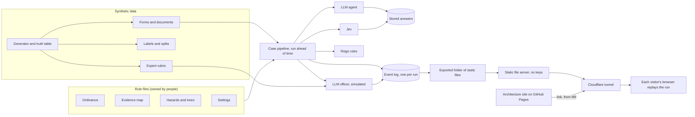
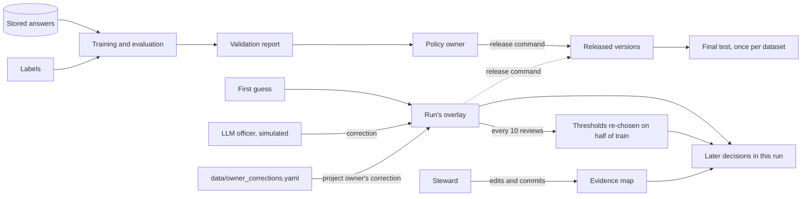

# Permit Engine: architecture site and working platform

*   **Author:** Alejandro Tabares (puedesleerlo)
*   **Status:** Proposed. Revised after review stage 8 and the project owner's decisions of 2026-11-03. Being built for the 2026-11-04 demo.
*   **Date:** 2026-11-03

--------------------------------------------------------------------------------

## Overview

Permit Engine is a decision system for public-event permits. A language model checks the evidence in an application, a second model answers narrow questions about what that evidence means, and written rules and arithmetic make the decision. A person handles anything uncertain. In the 2026-11-04 demo, an LLM plays that person's role and is labelled as simulated.

This design covers two pieces of work:

*   **The architecture site.** Static pages at `puedesleerlo.github.io/permit-engine/`, the address on the printed poster's QR code. They show the test results, what has changed since the poster, the Structurizr model, its dynamic views, failure modes and documentation, and they link to the platform.
*   **The platform.** A replay at `permit-engine.bottomuplabs.com`: one folder of static files, sent from the project owner's Mac through a named Cloudflare tunnel, with no keys and no server process. One finished run of synthetic street-race applications plays in each visitor's browser. Anyone can open a case to see how it was decided, and watch the learning plots move as corrections arrive.

The work starts with one experiment: **if the models that read the evidence stay frozen, can the weights of a decision tree learn from labelled applications and improve decisions on cases they never saw?**

## The 2026-11-04 demo

The demo is on 2026-11-04 at 10:00 and lasts two hours. Its build brief is [demo-build.md](demo-build.md), called "the brief" below. Where the brief and this document disagree, the brief wins for tonight.

*   **A finished run.** Cases are read, decided and ruled ahead of time. Nothing runs on the server during the demo.
*   **Each visitor's browser replays it** from the start, at a slow pace, from static files. A visitor changes nothing and triggers no model call.
*   **A video comes from the same replay,** for anyone who arrives when the Mac is off.
*   **An LLM plays the officer.** It follows the expert rubric, writes a one-line reason for each ruling, has its measured accuracy shown, and is always labelled "Simulated officer: an LLM following the expert rubric". A real deployment would use a person.
*   **Teaching starts from the first guess, and every officer review teaches,** because trained trees give a flat line and corrections alone made the first guess worse. See decision record [0004](../decisions/0004-how-the-demo-shows-learning.md).

## Terms used in this document

| Term | Meaning |
| --- | --- |
| Application, case, permit | An application is what someone submits. A case is that application moving through the system. A permit is only what gets issued |
| Base request | One application before it is rewritten in different tones |
| Hazard | One way an event can go wrong, such as a traffic conflict. Hazards can be reused across event types |
| Hazard screen | The step that decides which hazards apply to a case |
| Likelihood tree, severity tree | Each hazard has one of each. A tree is a short series of questions leading to a leaf |
| Question | A step in a tree. It is a `rule` (answered by Rego from the form), an `evidence` question (answered by the LLM's verdict on a document) or a `jev` question |
| Leaf | The end of a path through a tree. It holds a distribution over three levels, such as rare, possible, likely |
| Weights | The leaf distributions. These are what training changes |
| First guess | The weights a tree starts with, written before training |
| Anchor | The number a level stands for, set by the policy owner, such as 0.30 for "likely" |
| Risk | For each hazard that applies, likelihood times severity, then summed over those hazards |
| Severity ceiling | A limit on a case's highest severity. At or above it, the case always goes to an officer |
| Review band | The range of risk between two thresholds, `t_low` and `t_high`. Cases inside it go to an officer |
| Risk rows | Rows 4 to 6 of the decision table, reached by cases nothing has stopped earlier |
| Route | Where a decision sends a case: returned, proposed denial, approved, or officer |
| Evidence map | The steward's small map of requirements, evidence types, terms and clauses |
| Evidence record | The LLM's output for one evidence type on one case: found or absent, fields, quotes and a verdict |
| Open evidence | An `evidence` question whose verdict is not "supported" |
| Labelled risky | A case whose labels from the truth table put its risk at or above a cut. It describes authored data, not real risk |
| Read | One pass of model calls over a set of cases, such as the full read of 460 cases |
| Run | One finished pass of the demo, built ahead of time. Each run has its own event log file, and building a new one is how the demo resets |
| Overlay | Corrections applied to the current run only, not yet released |
| Release | A person making a new version of weights, thresholds or a tree official |
| Manifest | The list of hashes of everything a decision used |
| Stop switch | A control the policy owner can set. Every assessing case goes to an officer, and nothing is approved automatically until it is lifted |
| Case card | The hidden facts of one synthetic case. The models and the case pipeline never see it |
| Jev | A model from [TypeSafe](https://docs.typesafe.ai/api.md) with fixed weights. It answers narrow questions over a block of input it calls its `state`. A `noul` question returns the probability that a statement is true |
| Probe | A small run of the real Jev on synthetic cases, saved in `experiments/` |
| Rego, OPA | Rego is a policy language, and Open Policy Agent (OPA) runs it |
| Policy owner, steward, officer | Three roles. The policy owner owns rules and trees, the steward owns the evidence map, and the officer decides cases |
| Project owner | The author, who runs the system, sets budgets and handles deployment, and who plays the policy owner and steward roles. The project owner's real corrections come from a local file |
| LLM officer | The simulated officer in the demo: an LLM that stands in for a person, always labelled "Simulated officer: an LLM following the expert rubric" |
| Expert rubric | The truth table in plain words, in `generator/expert_rubric.md`. Only the LLM officer reads it |
| Right risk level | How often a tree's most likely level is the level the expert labels give. This is the number that rises in the demo |
| Decided without an officer | The share of cases the system finishes with no officer. It stays near flat in the demo, because about a third of cases can never be automatic |
| Precision | The share of automatic approvals not labelled risky |
| Export | The folder of static JSON files the replay plays. The brief gives its contract |

## The Problem

This design assumes that public offices and regulated firms want AI help with decisions they must be able to explain. A single AI model that reads an application and answers yes or no gives an answer, but its answer does not by itself show the facts and rules behind it. Its answer may shift with the tone of a letter, and when it is wrong there is no specific part to fix. The baseline in this experiment tests that view.

Permit Engine's response is to split the decision into parts that can each be checked and corrected. That leaves three problems unsolved today.

**1. Nothing exists to show.** The site at the QR code's address describes a design, but no engine or test results exist. Its Overview and Testing pages say "What I built". Anyone who asks to see the system finds nothing behind that claim.

**2. The published design has flaws.** The site's rule multiplies one probability per requirement into a single score, caps each probability at 0.9 at the start, and compares the product with 0.6 or 0.8 depending on risk. A review of an earlier version of this design found that the cap can stop larger cases from ever earning automatic approval, and that the site merges likelihood and impact into one tree. This design replaces that rule.

**3. Nobody knows what can learn.** The first learning target was a model's own weights, using an output head such as [LAYA](https://arxiv.org/abs/2511.12723v1), which learns how much to trust each hidden layer. Jev's weights are fixed and its API exposes no hidden layers, so that approach cannot work here. The open question is whether a small layer on top of fixed models can learn something useful, from a few hundred labelled cases, in a form a policy owner can read and control.

**Who this is for.** Employers and technical readers who follow the poster's QR code or ask for a demonstration. Some will test the claims, so the system must show what is real, what is simulated, and what it cannot prove.

**What this will not prove.** The data is synthetic, and its labels come from a truth table the author writes. The trees ask about the same factors that table uses, so training is close to guaranteed to learn it. Training can show that the mechanism works and can recover a planted pattern. It cannot show that the risk levels describe real events. The demo's learning plot has the same limit: the LLM officer follows a rubric written from that table, so the plot shows corrections carrying an expert's rule into the weights, not anything found independently. The main objection a careful reader can make is that the demo only proves its own machinery runs, and that objection stands until labels the author did not write exist.

## Goals

**Data**

*   Running the generator twice with one seed gives identical case cards, applications, labels and splits, checked by a hash.
*   One event type, a street race, with 400 base requests split into 180 train, 120 validation and 100 test, plus 60 tone cases.
*   The balance report meets its targets: about 20% of cases labelled risky, at most about 15% at the severity ceiling, and at least about 50 approvals expected in the test set.
*   Labels come from a truth table that tree files and training code cannot read.

**Rules as data**

*   Hazards, trees, the evidence map, the invented ordinance and all settings are data files. Changing a value needs no code change.
*   Every policy setting has limits, an owner and a log.
*   The first guess in each tree is written from the ordinance, hazard list and question lists alone, by a fresh agent working in a folder that holds only those files. Otherwise the size of the gain from training means little.

**Learning**

The experiment **passes** if, on the sealed test set, all three of these hold, and otherwise it is published as a fail:

*   **Lower loss.** Trained trees have lower loss than the first guess and the shuffled-label control, with each 95% interval on the difference excluding zero.
*   **More approvals.** Trained trees approve a larger share of cases automatically than the first guess, with a 95% interval on the difference excluding zero.
*   **No clear safety failure.** The experiment fails on safety only if the test clearly shows risky approvals above 5%: the lower end of the 95% Wilson interval on the share labelled risky among approvals is above 5%.

See decision record [0003](../decisions/0003-what-counts-as-passing.md). Beating the control shows that the labels matter, not that the system has found anything beyond them. Jev asked directly is reported beside these results on the same cases. It is not part of the pass rule, because Jev has never seen the author's truth table, so beating it says little while the labels are the author's own. See decision record [0002](../decisions/0002-compare-the-trees-with-asking-jev-directly.md). The other goals:

*   Two thresholds are chosen on validation to aim for the policy owner's targets: at most 5% labelled risky among automatic approvals, and at least 85% labelled risky among cases marked high risk. The method tends to fall short of its targets, and the test set is too small to confirm them, so the report gives what happened, with its interval.
*   The traffic likelihood tree is planted with a missing question about major crossings. It is flagged by its entropy, adding the question lowers validation loss, and the policy owner releases the change before the final test.
*   In the replay, teaching starts from the first guess, every officer review teaches, and thresholds are re-chosen every 10 reviews. Cards and plots lead with right risk level, with "Decided without an officer" and precision beside it. Each review shows its old and new weights and the counts behind them. See decision record [0004](../decisions/0004-how-the-demo-shows-learning.md).
*   All reports describe released weights. The replay's corrected first guess is labelled as such, and it has no test result.

**Decisions**

*   Any logged decision can be reproduced with no model calls and an identical result.
*   No permit is issued without a logged rule decision or officer ruling.
*   In the design, no model decides: the LLM agent and Jev read and answer, rules decide, and a person handles anything uncertain. No reading model has a tool that decides, issues, or changes a setting, and that holds in the demo too.
*   In this demo an LLM plays the officer role and does decide the cases sent to an officer, always labelled as simulated. A real deployment would use a person.
*   Two failure modes are reported separately. A **forbidden permit** is an approval the ordinance does not allow. A **risky approval** is an approval of a case labelled risky.
*   The flip rate across four tones is reported for 20 test requests, on the extracted evidence and on the decisions, against a noise floor from re-reading the same tone.
*   All 160 test cases also run through a baseline, one AI model that reads the application and answers approve or deny. Its results are published even if it does better.

**What people can see**

*   Any visitor can open the replay, any case and the learning view, with no login. Visitors cannot change anything and trigger no model calls.
*   One case page takes a reader from the documents to the rule that fired, including the evidence links, the hazards that applied, both trees for each hazard, and the risk against the review band.
*   A case sent to an officer shows why it went there, and the simulated officer's ruling and one-line reason.
*   A learning view shows first guess against trained, the control, leaf entropy, the run's corrections, the crossings question's validation result, and the LLM officer's measured accuracy.
*   Everything synthetic, simulated or stored is labelled on screen.
*   **The architecture site, at M7,** shows the test results and a permanent note saying what has changed since the printed poster, and it has removed or moved the claims the design no longer makes. **At M9,** it adds the Structurizr model with stepped dynamic views, the failure modes, a link to the replay, and a video for when the Mac is off. It makes no claim the platform contradicts.

## Non-Goals

*   Training or fine-tuning any model, including Jev, or adding a trainable head on model internals.
*   Real applicants, real ordinances, or real incident rates.
*   A full ontology, SKOS, or a triple store. The evidence map stays small.
*   Live trust counters, random audits and blind rulings. These wait for real traffic, because labels do the same job here. See "Blind rulings" under Alternatives.
*   Learning how to learn: tuning how fast the system learns and how much officers check. It stays in the documentation, labelled as not built.
*   Visitors ruling on cases, or any per-visitor state beyond each browser's place in the replay.
*   High availability. The platform runs from one Mac for the two hours of the demo, and is otherwise sometimes offline.
*   In the design, a model that decides, issues a permit, or changes a setting. The demo's one exception is the labelled LLM officer, which stands in for a person and has no tools.
*   A public server process, a live admin view, or anything that holds keys while visitors are connected.
*   Letters asking an applicant for proof. A missing requirement goes to an officer.
*   A proposals screen, What if reports, or retracting a correction. A `release` command makes weights official.
*   More than one event type before the first passes.
*   Appeals and event outcomes as running code.

## Open Questions

*   **Public source:** whether `permit_engine` and its experiments become public. Readers could test more if they do, but the code names the LLM vendor, which public pages do not. Until this is decided they stay private, and the site publishes the results.

## Critical User Journeys (CUJs)

### CUJ 1: The project owner runs the experiment from nothing

*   **Given**: An empty data folder, the seed, and the rule files.
*   **When**: The project owner runs `generate` and `lint`, then `simulate` or `read`, then `train`, `thresholds` and `report`.
*   **Then**: The same dataset hash appears each time, and a report shows first guess, trained and control results on validation. After `release`, the test set stays sealed until `final-report` runs once.

### CUJ 2: A visitor watches a replay reach its decisions

*   **Given**: The Mac is on, the tunnel is running, and the static file server is sending the exported folder. The visitor came through a link.
*   **When**: The visitor opens the page. The finished run plays from the start at a slow pace in their browser. They open one case.
*   **Then**: They see the documents, the evidence linked to each requirement with its quote, which hazards apply, both trees for each hazard, the risk against the review band, the rule that fired and the clause behind it. Synthetic, simulated and stored items are labelled, and no action buttons appear. A case sent to an officer shows the simulated officer's ruling and reason. If the Mac is off, the visitor can watch the video made from the same replay.

### CUJ 3: An unsure case goes to an officer

*   **Given**: The decision table sent a case to an officer while the run was being built, for a reason such as `review_band`, `unmapped_evidence` or `requirement_missing`.
*   **When**: The LLM officer reads the documents, the reason and the expert rubric.
*   **Then**: The ruling approves the application and issues a permit, signs a proposed denial, rejects a proposed denial and approves instead, or denies directly. It writes a one-line reason. Each step is logged and labelled as simulated. In a real deployment a person does this.

### CUJ 4: An officer corrects a past decision

*   **Given**: A decided case the LLM officer believes was wrong, or an entry the project owner has written in `data/owner_corrections.yaml`.
*   **When**: The correction records the right outcome: risky or not. It says whose mistake it was: the AI, a person, a changed context, or a genuine exception. If it was the AI, it can also name a hazard, whether likelihood or severity was wrong, and the right level, or leave that blank.
*   **Then**: In the demo, the officer's outcome and its level for each tree teach the weights, whether it agreed with the system or not. The overlay updates, and the replay shows old and new weights and their counts. Later decisions in the run use the overlay and say so. Every 10 reviews, thresholds are re-chosen and the learning plots move. An entry from the project owner is logged as theirs, not as simulated.

### CUJ 5: The policy owner releases a change

*   **Given**: A candidate exists. It is either fitted weights, new thresholds, a tree change, or the run's overlay.
*   **When**: The policy owner reads its validation result in the report.
*   **Then**: They run the `release` command under a new version, or do nothing. Past decisions can still be reproduced under their old version. The final test result stays tied to the version it tested, and later versions show "no test result".

### CUJ 6: The steward handles unfamiliar evidence

*   **Given**: An applicant attaches proof that fits no evidence type in the map, such as a broker's letter for insurance.
*   **When**: The linking step lists it as an unmapped document.
*   **Then**: An officer decides this case. The document appears on the case page and in the report's list of unmapped evidence. The steward adds a mapping with a cited clause by editing the evidence map file, or adds it to the map's list of evidence that does not count. Before any re-read, `read --dry-run` counts what it would cost.

### CUJ 7: A technical reader inspects the architecture

*   **Given**: A reader who scanned the poster's QR code.
*   **When**: They open the architecture site and step through a dynamic view of one case.
*   **Then**: They see the test results and what has changed since the poster. From M9, they also see the components, how a case moves between them, what fails and what happens when it does, and a link to the replay.

## Technical Plan (Architecture)

### Decisions made by the project owner

| Decision | Choice | Record |
| --- | --- | --- |
| Risk formula | Likelihood times severity per hazard, summed | Alternatives |
| What trains | Leaf weights and thresholds, with the reading models frozen | Alternatives |
| Roles of the models | The LLM links and judges evidence. Jev answers the tree questions. In the demo, a separate LLM call plays the officer | Alternatives, [0004](../decisions/0004-how-the-demo-shows-learning.md) |
| Corrections | One Bayesian network: the outcome always, a named tree optional | [0001](../decisions/0001-how-corrections-update-the-trees.md) |
| Comparisons | A baseline model and Jev asked directly, on all test cases | [0002](../decisions/0002-compare-the-trees-with-asking-jev-directly.md) |
| What counts as passing | Lower loss than first guess and control; more approvals than first guess; fail only if the test clearly shows risky approvals above 5% | [0003](../decisions/0003-what-counts-as-passing.md) |
| How the demo shows learning | A finished run, an LLM officer with the expert rubric, teaching from every review starting at the first guess, and thresholds re-chosen every 10 reviews | [0004](../decisions/0004-how-the-demo-shows-learning.md) |
| Where the code lives | Everything for this platform in `repos-new/permit_engine`. `gov_design` stays the design system and poster. Moving `gov_design/site` here waits until after the demo | Alternatives |
| Event log | One SQLite file per run, append-only, plus a folder of prompts and responses named by content hash | Alternatives |
| Architecture diagrams | A custom viewer drawn with the design system, from the exported Structurizr model. A simple stepper or Structurizr's static export if time runs short | Alternatives |
| Public access | A plain static file server sends one folder of exported files through a named Cloudflare tunnel, with no keys and no server process. Visitors watch only | Alternatives |
| The project owner's corrections | Entered from a local file, `data/owner_corrections.yaml`. No admin view is public | Alternatives |
| Missing requirement | Goes to an officer. The letter path is cut | Alternatives |
| Releases | A `release` command, with no proposals screen and no What if | Alternatives |
| Hazard screen | Rules only. The LLM extracts expected spectators | Alternatives |
| Severity ceiling | 0.85, and the data must put at most about 15% of cases at it | "The data" |
| Public wording | Public pages and exported files say "agentic LLM", with no vendor or model named | "The architecture site" |
| Spending | $30 in total for the LLM | "Cost" |

### System at a glance

The first diagram shows how a run is built and reaches visitors. The second shows how weights change.





The generator and labels never feed the pipeline directly. Labels reach only training and evaluation, and the export's comparison of each case with its label. The expert rubric reaches only the LLM officer. Two sets of weights stay apart: the trained, released weights are what the final test measures, and the corrected first guess is what the replay shows.

### Where each thing lives

| Place | Holds | Why |
| --- | --- | --- |
| `repos-new/permit_engine` | Engine, rule files, generator, training, replay interface and its components, exported run, Structurizr model, experiments, this design and its decision records. After the demo, the architecture site source too | The platform and its description change together, with nothing copied by hand between repositories |
| `repos-new/gov_design` | The `@permit-engine/ui` design system and the poster. Until after the demo, also the architecture site source, edited where it is | A library the platform imports as a local package |
| `puedesleerlo/permit-engine` on GitHub | The built architecture site | The URL on the poster's QR code must not change |

New interface components stay in `permit_engine/web` until a second use appears.

### The data

The data comes first, because the trees, thresholds and training all depend on it. There is one event type, a street race, and a short invented ordinance for a fictional city.

| Split | Base requests | Use |
| --- | --- | --- |
| Train | 180 | Fit tree weights |
| Validation | 120 | Choose thresholds, test the crossings question, fit thresholds for Jev asked directly, and supply the demo's replay |
| Test | 100 | Sealed, used once for the final report. Its cases are never shown in the demo or corrected |
| Tone variants | 60 extra | 20 test requests rewritten in 3 more tones. These count only for flip rates |

Splits are made by base request, so the tones of one request never cross a split. Some families of written variants appear only in the test split, so accuracy is not flattered by repeated templates. The final report compares those held-out families with the seen ones, and has no table per family, because 100 test cases would make each count too small.

**Each case has three parts, kept in separate files:**

| Part | Holds | Who reads it |
| --- | --- | --- |
| Case card | The facts of the case, from a seed: what is really arranged and what evidence is in the file | The generator, simulated answers and evaluation. Never the models or the pipeline |
| Application | A structured form and attachments as text, rendered from the card using written variants | The LLM, Jev and Rego |
| Labels | Whether each hazard applies, likelihood and severity levels, requirement status, risky or not, and the right route | Training and evaluation only |

**Reality and evidence vary separately.** A race can have an escort arranged with no letter in the file, or a letter that names another date. Labels follow reality, and trees read evidence. This is why a branch like "no proof of the escort" holds a real mix of outcomes.

**The form** has these fields: organizer, event type, event date, expected runners, a free-text description that may mention spectators, route (road closure yes or no, arterial road yes or no, count of major crossings), hospital distance, fee paid, and a list of attachments.

**The case mix.** A uniform mix would send too few cases to the risk rows, so the mix is set deliberately:

| Factor | Mix |
| --- | --- |
| Form | Fee paid and complete in 96% of cases |
| Crowd | Under 300, 300 to 800, over 800, one third each |
| Route | Road closure 70%; arterial road 50%; many major crossings 50%. At 70%, the eight-leaf crossings tree averages 15.75 training cases per leaf against a minimum of 15, so the draw is stratified or the closure share is raised |
| Escort evidence (where a road closes) | Letter 50%, email only 20%, none 25%, a letter that contradicts the form 5%. An email counts as an evidence type with lower reliability |
| Arranged but no proof | Where evidence is absent, the thing is really arranged in 30% of cases |
| Plans | Traffic, crowd and medical plan, each written as adequate or inadequate, half each |
| Conditions | Hot date, narrow venue, ambulance on site, hospital far, half each |
| Insurance (a legal requirement) | Valid 70%; expired, wrong venue, broker letter, or missing, 7.5% each. The broker letter is not in the evidence map, which exercises CUJ 6 |
| Cover letter tone | Plain, except the tone variants: persuasive, insistent, "I know the mayor" |

**Labels come from a hidden truth table** in the generator. It sets each level from the case facts, including one factor the first traffic likelihood tree does not ask about: the number of major crossings. Then 8% of level labels move one level, to imitate disagreement between experts. Tree files and training code cannot read this table. From the labels:

*   A case is **labelled risky** if its labelled risk is at or above a cut in `generator/config.yaml`, set so that about 20% of cases qualify.
*   A case is **allowed** if every requirement is really met.
*   The **right route** is returned if the form is incomplete, a denial if not allowed, an officer if allowed and risky, and approval if allowed and not risky.

**The balance report checks these targets, and M1 stops if they are missed:** about 20% labelled risky, at most about 15% at the ceiling, and at least about 50 approvals expected in the test set. Once tree files exist in M2, a lint check also requires at least 15 training cases per leaf of every tree, including the proposed crossings tree. The simulation's truth table rates too many hazards critical, so the real one must be set to meet these. See "Experiments behind this design".

**The expert rubric,** `generator/expert_rubric.md`, is the truth table in plain words. Only the LLM officer reads it. It never reaches the first guess author, the trees or training.

**Planted patterns for testing the agent:** a form that only asserts insurance, insurance naming the wrong venue, a substitute evidence type, a letter naming another date, and instructions hidden in an attachment.

**The order of work on data:** the generator and training first run with simulated answers and no API calls. Then 5 real cases measure cost, before the rest run.

### Hazards and the risk formula

An event type lists its candidate hazards. The hazard screen decides which apply, by rules only, using the form and extracted fields. A new event type then needs only a new list. A hazard the screen misses never reaches the sum, and weights cannot fix that, so the screen is measured separately against the labels.

**Crowd** means expected runners plus expected spectators, everywhere. The LLM extracts expected spectators from the description as a typed field with a quote. **A hot date** is one in June, July or August, as the invented ordinance says.

| Hazard | Applies when | Likelihood questions | Severity questions |
| --- | --- | --- | --- |
| Traffic conflict | Road closure | Escort confirmed (evidence); traffic plan adequate (Jev) | Arterial road (rule); crowd over 800 (rule) |
| Crowd pressure | Crowd of 300 or more | Crowd plan adequate (Jev); crowd over 800 (rule) | Narrow venue (Jev); crowd over 800 (rule) |
| Medical emergency | Always, for a race | Medical plan adequate (Jev); hot date (rule) | Ambulance on site (evidence); hospital far (rule) |

Jev answers four questions: the three plans, and the narrow venue, judged from the race plan. The planted crossings question, `many_major_crossings`, is a `rule` question from the form: 3 or more major crossings. It adds no model call and no re-read.

Each tree gives a distribution over three levels, and each level has an anchor set by the policy owner.

| Scale | Levels and anchors |
| --- | --- |
| Likelihood | Rare 0.02, possible 0.10, likely 0.30 |
| Severity | Minor 0.1, serious 0.4, critical 1.0 |

`risk = Σ (likelihood × severity)`, over the hazards that apply. There is no separate weight per hazard, because it could not be told apart from a change in that hazard's severity. The sum assumes each hazard's harm can be added to the others, and the anchors are policy values, not measurements. The severity ceiling exists because the product can hide a rare catastrophe: a case whose highest severity reaches it always goes to an officer, however small its likelihood.

### The evidence map and settings

**The evidence map** is small and owned by the steward. It holds:

*   **Evidence types**, the controlled vocabulary, each with the typed fields to extract and its allowed source documents. For example, `certificate_of_insurance` has named insured, venue, start date, end date and coverage.
*   **Terms** that mean each type, such as "COI" or "póliza".
*   **Requirements**, such as event liability insurance, each stating: this requirement can be met by evidence type X, under clause C.
*   **Evidence that does not count**, recorded by the steward with a reason.

**How the parts connect.** The pipeline builds a list of evidence types the case needs: those named by requirements, and those named by `evidence` and `jev` questions in the trees of its candidate hazards. The LLM gets only those types. For each, it returns:

*   **`found` or `absent`.** Absent means no document for this type. It is not an error.
*   **Fields with quotes,** if found. Each value must appear in its quote, or that field counts as absent.
*   **A verdict,** which judges one claim: does this document establish what this evidence type requires, for this case? Supported, unsupported or contradicted.

Separately, it lists **unmapped documents**: attachments that fit no type. That is a different thing from an absent type, and only it fires `unmapped_evidence`.

**Code then compares fields with the form,** for every evidence type. A mismatch, such as a letter naming another date, makes the record `contradicted`, whatever the LLM's verdict said.

**A requirement's status** comes from its evidence record:

| Status | Means |
| --- | --- |
| Met | Fields match the case, and the verdict is supported |
| Failed | A document exists, and a field fails a rule, such as an expired date or a wrong venue |
| Missing | The evidence type is absent |
| Unclear | The verdict and the fields disagree |

**Settings** share one format. One file feeds the engine and, through `rules.json`, the replay's read-only rules view, so the two cannot disagree. A value outside its limits stops the run, with no silent clamping. API keys are not settings: they come from environment variables. Thresholds live with released weights, and settings hold only the targets.

```yaml
- key: decision.risky_approval_target
  value: 0.05
  limits: { min: 0.01, max: 0.15 }
  owner: policy_owner
  recheck_after_days: 90
  affects: [t_low, officer_load]
  why: The share of automatic approvals the city accepts being labelled risky.
  if_raised: More events are approved automatically, and risky approvals may rise.
```

Recheck dates are displayed, and nothing acts on them yet, because the demo's clock is simulated.

**Who owns what:**

| Part | Job | Never does |
| --- | --- | --- |
| LLM agent | Finds evidence for each needed type, extracts fields with quotes, judges each record, lists unmapped documents | Decides, issues, or changes a setting |
| Jev | Answers semantic tree questions from typed values, evidence records and whole plan documents | Reads the cover letter or judges evidence |
| Code | Generates data, checks quotes, compares fields, does the arithmetic, trains | Holds policy values |
| Rego | Basic checks, requirement status, rule questions, the hazard screen, decision table | Calls a model or does tree arithmetic |
| Policy owner (a person) | Owns trees, hazards, anchors, ceiling and targets. Releases changes. Sets the stop switch | Edits the evidence map |
| Steward (a person) | Owns the evidence map, its vocabulary and the evidence probabilities | Edits rules or trees |
| Officer (a person in a real deployment) | Decides cases sent to an officer and corrects past ones | Changes rules |
| LLM officer (the demo's stand-in for the officer) | Follows the expert rubric, rules with a one-line reason, corrects past decisions, and is always labelled as simulated | Reads labels or case cards, uses tools, releases anything, or changes a setting |
| Project owner (a person) | Runs commands, sets models and budgets, handles deployment, and writes real corrections in `data/owner_corrections.yaml` | Plays a role without saying which: each action is logged with its role |

### What happens to one case

| Stage | Done by | Input | Output |
| --- | --- | --- | --- |
| 1. Basic checks | Rego | Form | Pass, or which check failed. On a failure, the case stops here and no model is called |
| 2. Link and extract | LLM, first pass | Form, attachments, cover letter, needed evidence types | Per type: found or absent, typed fields, quotes. Expected spectators. Unmapped documents |
| 3. Quote check | Code | Quotes, allowed sources | Each quote verified, and each value found in its quote, or the field counts as absent. The form and cover letter are never allowed sources |
| 4. Judge | LLM, second pass, fresh context | Evidence types, verified passages, the case's typed values. Never the cover letter | One verdict per found type, with a reason for "unsupported" |
| 5. Requirement check | Code, Rego | Fields compared with the form | Evidence records marked contradicted where they mismatch. Requirement statuses, each citing a clause |
| 6. Rule answers | Rego | Form, extracted fields | Answers to every `rule` question |
| 7. Hazard screen | Rego | Form, extracted fields | Which hazards apply |
| 8. Tree questions | Jev | Typed values, evidence records, whole plan documents | A probability per `jev` question, for hazards that apply |
| 9. Tree arithmetic | Code | Rule, evidence and Jev answers, weights | Likelihood and severity per hazard, entropy, each leaf's contribution, risk sum, highest severity |
| 10. Decision | Rego | Everything above, thresholds, stop switch | Row fired, route, reason, clauses |
| 11. Officer ruling | The LLM officer in the demo; a person in a real deployment | Documents, decision and reason, expert rubric | For a case sent to an officer: a ruling and a one-line reason |
| 12. Log | Code | Each stage's input and output | Events. If the write fails, the decision does not take effect |

**Basic checks:** the fee is paid, the form is complete, and the event date is in the permitted window.

**Rego runs as an `opa eval` subprocess** with a pinned version. A capabilities file removes the built-ins for network calls, time, random numbers and unique IDs, so a policy that tries to reach outside itself fails to load. Rego is a pure function of its stored input.

**The decision table, first match wins.** This is the table in the brief, which also gives the Rego inputs and outputs.

| Row | If this is true | Then | Reason code |
| --- | --- | --- | --- |
| 0 | A basic check failed | An incomplete form is returned. A failed rule becomes a proposed denial that an officer signs | `form_returned`, `basic_rule_failed` |
| 1 | **The system will not decide this case alone:** an evidence record is contradicted; a requirement is unclear; there are unmapped documents; a model failed or refused; Rego failed; the stop switch is on; or the highest severity is at or above the ceiling | Officer decides | `red_flag`, `requirement_unclear`, `unmapped_evidence`, `model_failure`, `policy_unavailable`, `stop_switch`, `severity_ceiling` |
| 2 | A requirement failed | Proposed denial citing the clause. An officer signs | `requirement_failed` |
| 3 | A requirement is missing | Officer decides | `requirement_missing` |
| 4 | Risk is under `t_low` | Approve | `approved` |
| 5 | Risk is at or over `t_high` | Officer decides | `high_risk` |
| 6 | Anything else | Officer decides | `review_band` |

Open evidence stays soft in the trees. A case under `t_low` with open evidence is approved at row 4.

**What an officer can do.** Approve, which issues the permit; sign a proposed denial; reject a proposed denial and approve instead; or deny directly. Every action is logged, and `permit.issued` always has a logged decision or ruling as its parent. Revoking an issued permit is not built.

**States of a case:** submitted, basic checks, assessing, officer review, approved, returned, denied. Each move is an event. A test checks that every state ends within a fixed number of steps, given a ruling. Time in the demo is a simulated clock, set when the run is built and passed in as input, so replay stays exact.

**Worked example (all numbers illustrative).** A running charity applies for a 5K race: 400 runners, no spectators mentioned, one road closure, no arterial road, a June date, an ambulance on site, a nearby hospital, and a valid insurance certificate. No police escort letter is attached.

1.  **Basic checks:** the fee is paid, the form is complete and the date is allowed. Pass.
2.  **Link and extract:** the needed types include `certificate_of_insurance`, which is found with its fields, and `police_escort_letter` and `police_escort_email`, which are absent. No documents are unmapped.
3.  **Quote check:** the insurance quotes appear word for word, and each value appears in its quote.
4.  **Judge:** insurance is supported. The escort has no document, so its verdict is unsupported, with reason `no_evidence`.
5.  **Requirement check:** the certificate's venue and dates match the case, so insurance is met. The escort letter is not a legal requirement here, so it does not stop the case.
6.  **Rule answers:** arterial road no, crowd over 800 no, hot date yes, hospital far no.
7.  **Hazard screen:** traffic applies because a road closes, crowd because 400 is 300 or more, and medical always.
8.  **Tree questions:** Jev gives a probability for each of its four questions, such as 0.8 that the traffic plan is adequate.
9.  **Tree arithmetic:**

    | Hazard | Likelihood | Severity | L × S |
    | --- | --- | --- | --- |
    | Traffic, no letter | 0.217 | 0.28 | 0.061 |
    | Crowd | 0.072 | 0.22 | 0.016 |
    | Medical | 0.080 | 0.31 | 0.025 |
    | **Sum** | | | **0.102** |

10. **Decision:** with `t_low` 0.08 and `t_high` 0.25, no earlier row fires: nothing is contradicted, the highest severity is under the ceiling, and no requirement failed or is missing. The risk of 0.102 is over `t_low` and under `t_high`, so row 6 fires, with reason `review_band`, and an officer decides. The same application with a supported escort letter would have traffic likelihood 0.070 and a sum of about 0.06, under `t_low`, and would be approved at row 4.
11. **Officer ruling:** the LLM officer reads the documents and the expert rubric, and rules with a one-line reason. If it approves, the permit is issued, with the ruling as its parent. The ruling is labelled "Simulated officer: an LLM following the expert rubric". In a real deployment a person rules.
12. **Log:** every stage above is written as events, with the manifest.

### The reading models

**LLM agent.** Two fixed passes using structured outputs, so each response must fit a schema. There is no tool loop, so the agent has no tool that could decide or issue anything. The prompt starts with a fixed block holding the needed part of the evidence map, which is cached. The log records which model answered, and only one model is used per read. A refused or malformed response, after one retry on bad schema, goes to an officer as `model_failure`. Effort starts at `low` and is tested on the first 5 cases. Batch processing waits until those 5 cases show whether it is worth building.

**Why one pass reads the cover letter.** If the LLM never saw it, the tone test would pass by construction and prove nothing. So the first pass reads it, and code stops it from being evidence. The test then measures whether tone changes what the LLM links or extracts. The second pass and Jev never see it.

**Jev.** One request per case, with one state: the form's typed values, the evidence records and the whole plan documents its questions need. The tree file lists which of these each question needs, and they are merged into that one state. The returned model is checked against the pinned one, and a mismatch is a failure. No more than 4 requests run at once, because [TypeSafe's feature-discovery cookbook](https://docs.typesafe.ai/cookbooks/autoresearch_feature_discovery.md) reports rate limits on a shared key at 8.

**Why Jev and not only the LLM.** Jev returns a probability for a narrow question, and a probability is what a tree needs to split a case. Whether that adds enough to justify a second model is an open result: the removal test replaces each Jev question with its mean over validation cases and counts how many decisions flip, and near zero would be a valid finding.

**Stored answers.** Every model call is keyed by a hash of its kind, full payload, canonical input and model ID, not by case. Replay and the public demo then need no calls. A first pass rarely repeats, because its input is the whole application, so a change to it means reading again. Each call gets only the evidence types its case needs, so adding a type changes only the cases that need it. `read --dry-run` counts cache misses before any re-read. Because a repeated input cannot show a model's own noise, stability is measured by a separate sample that bypasses the cache.

**Evidence probabilities.** A verdict becomes a probability through a settings table owned by the steward (supported 0.9, unsupported 0.1, contradicted 0.05). The table is not trained in this experiment.

### Trees, training and thresholds

**A tree file** lists its questions and leaves. A lint test fails on an unknown rule, evidence type or setting, or a leaf that does not sum to 1. Rule questions reference Rego by name and never restate it. Jev questions compile into a Jev request.

```yaml
id: traffic.likelihood
version: 1
owner: policy_owner
hazard: traffic_conflict
scale: likelihood            # or severity
questions:
  - id: escort_confirmed
    kind: evidence           # evidence | rule | jev
    evidence_types: [police_escort_letter, police_escort_email]
    clause: ORD-12.4
  - id: traffic_plan_adequate
    kind: jev
    instructions: Does the traffic plan cover every road closure on the route?
    needs: [route, traffic_plan]
    clause: ORD-12.2
leaves:                      # first guess, one row per leaf; four rows in all, two shown
  - when: { escort_confirmed: true, traffic_plan_adequate: true }
    levels: [0.8, 0.1, 0.1]  # rare, possible, likely; or minor, serious, critical
  - when: { escort_confirmed: false, traffic_plan_adequate: true }
    levels: [0.1, 0.8, 0.1]
```

**Evaluating a tree.** Each answer is a probability of yes. A rule answer is 1 or 0, so it sends the case one way. An evidence or Jev answer sends part of the case down each branch, which this document calls soft routing. A case reaches each leaf with the product of the answers along its path. The tree's output is the leaf distributions weighted by those amounts. Likelihood or severity is then the sum of each level's probability times its anchor. A leaf's **contribution** is its share of that sum.

**Training.** For each tree: start with the first guess as two pseudo-cases per leaf, then repeat six times: for each labelled training case, split it across leaves in proportion to the amount that reached each leaf times how well that leaf explains the label, and add those shares to the leaf's counts. This is expectation-maximisation on a fixed tree. It reads stored answers and labels, needs no model calls, and is expected to run in seconds. `simulate` writes simulated answers in the same format, so all of this can run before any model is called.

**Thresholds.** Chosen on validation cases that pass basic checks and are under the severity ceiling, from their risk scores and labels. Requirement status does not affect a case's risk label, so cases with failed requirements stay in.

*   `t_low` is the highest value where cases below it are at most 5% labelled risky.
*   `t_high` is the lowest value where cases at or above it are at least 85% labelled risky.
*   If they cross, both take their midpoint, and there is no review band.
*   If no value meets a target, that threshold sits at the end of the range, so nothing is approved automatically or nothing is marked high risk, and the report says so.

Choosing the extreme value that just meets a target tends to fall short on new cases. The validation report therefore also scores the population that actually reaches row 4. In the replay, thresholds are re-chosen by this same rule every 5 corrections, because thresholds fitted to one set of weights do not fit the next. See decision record [0004](../decisions/0004-how-the-demo-shows-learning.md).

**The M5 checks, with no model calls unless stated.** Soft and hard routing are compared on validation. Jev's answers are compared with the case cards on the training split, and the calibration error is reported, with no fit. TypeSafe's documentation says its models are trained for calibrated decisions, but that is unverified for this domain. Jev asked directly runs on the 120 validation cases to fit its thresholds, which is 120 extra requests, so that its approvals can be reported. It is the first of the comparison work to be cut if time runs short, and then its loss and right level are still reported.

**Evaluation.** `report` compares first guess, trained and shuffled labels on loss and on outcomes per route, on validation. The test set is sealed by a ledger in `ledger/`: `final-report` runs once per dataset hash, with no exception for new trees or weights, against a version named in the ledger beforehand. Later versions show "no test result" unless a new test split is generated.

Evaluation counts officer routes as "sent to officer", and the LLM officer's rulings play no part in the final test. Accuracy metrics use the 100 base cases, and tone cases count only for flips. Rates use Wilson intervals, and loss differences use a bootstrap clustered by base request. The final report gives:

*   Loss per tree against the first guess, the control and Jev asked directly.
*   Forbidden permits and risky approvals, each with its interval.
*   Wrong denials, and the share of cases sent to officers.
*   Coverage: the share approved automatically, against the share labelled risky among them, for the trained trees, the first guess and Jev asked directly. Jev asked directly's row needs its validation requests.
*   The baseline, scored two ways, because it must answer every case while the engine can pass hard cases to officers. Once on all cases, and once on the cases the engine decided automatically.
*   How many real hazards the screen caught, and what happened to each planted pattern.
*   Results on held-out families of written variants against seen ones.
*   Flip rates, where a flip on evidence is a changed verdict or field, and a flip on decisions is a changed final route, against a noise floor from re-reading 20 plain cases past the cache.

**What these sizes cannot show.** About 3 risky approvals in 52 gives a Wilson interval of roughly 2% to 16%, so the test cannot confirm a 5% target. This is why the pass rule fails on safety only when the test clearly shows risky approvals above 5%, which at that size takes about 6 risky approvals in 52. Zero flips in 20 requests still allows about 16%. The report states this.

**Entropy and loss are different signals.** Loss on a case says how wrong that prediction was, and it drives training. A trained leaf's entropy says that cases reaching that branch have mixed outcomes, which points to a missing question. A prediction's entropy says the system is unsure about this case, and needs no label. A single confident mistake has low entropy and high loss.

**What a correction does.** See decision record [0001](../decisions/0001-how-corrections-update-the-trees.md). A correction is evidence for one Bayesian network: tree levels lead to risk, and risk leads to the outcome, with the midpoint of `t_low` and `t_high` and a soft edge standing for "risky". The simulation behind the demo's curve keeps that midpoint at the starting thresholds. Moving it as thresholds are re-chosen has not been simulated.

*   The officer's outcome is always evidence. If they name a tree and level, that level is fixed as evidence too.
*   Inference is exact, by enumerating the levels of up to six trees, which takes well under a second.
*   It gives each tree a probability for each level on this case. Those shares, split across leaves as in training, are added to leaf counts, after discounting old counts on the leaves the case reached by `corrections.discount` (0.93).
*   In the demo, every review teaches, with a level named for each tree that applies. Teaching only from disagreements made the first guess worse, because it learns only from cases the system got wrong. See decision record [0004](../decisions/0004-how-the-demo-shows-learning.md). On a well-filled leaf, change is slow: one correction on a leaf of 47 cases moves its largest weight from 0.858 to 0.839.

**Where corrections live.** Released weights are committed files and never change in place. Corrections are events in the current run's log, and the overlay is derived from them. In the demo the overlay starts from the first guess. Decisions in that run use the overlay and record the last correction they saw. They have no test result, and the screen says so. A new run discards the overlay, which is also how a bad correction is removed. Test-split cases are never in the run, so they cannot be corrected. To keep a run's corrections, the policy owner runs `release --kind overlay`, which chooses thresholds again on validation, and that version shows "no test result". The learning view shows the overlay's loss per tree, read only on validation cases that have not themselves been corrected, so a corrected case does not score its own correction. That is how a bad correction is noticed.

**Flags and releases.** A tree is flagged when its mean leaf entropy is the highest of all trees and above `trees.entropy_flag` (0.6), counting leaves with at least 15 cases. For this experiment, the crossings question is authored in advance in `rules/proposals/`, and labelled so. The report gives its validation loss, with no model calls, because it is a `rule` question.

Only the policy owner releases, using the `release` command, for weights, thresholds, a tree change or the overlay. There is no proposals code or screen, and no What if report. The rule is between roles, not people, because one person plays them here.

**The order around the final test.** At the M5 stop: train, flag the tree, test the crossings question on validation, release it if validation loss falls, then release weights and thresholds. The final test covers those released trees, and their version is named in the ledger first.

### The event log

One SQLite file per run. Triggers reject updates and deletes. A new run starts only on the project owner's command, and the last 5 run files are kept. The log guards against mistakes, not against someone with access to the file.

Each event holds: sequence number, run, case, base request, tone, type, parent events, actor (system, LLM, Jev, a role, or the script), whether the actor is simulated, simulated time, a manifest hash and a payload. The event and any derived state are written in one transaction.

**The manifest** lists the hash of everything a decision used: Rego bundle and OPA version, tree files, weights, last correction applied, thresholds, evidence map, settings, LLM model and prompt versions, Jev model and question set, engine commit and arithmetic version (the version of the code that does the tree arithmetic).

**Reproduce** reruns one decision from stored inputs, with no calls allowed, and asserts an identical result. It refuses if any artifact is missing, or the arithmetic version differs.

**Backups.** `cache/`, `runs/` and `data/owner_corrections.yaml` are ignored by git, and the first two hold answers that may cost about $30 to replace and may not come back identical. `permitengine backup` copies them outside the repository after each stop. The spend meter and the test ledger live in `ledger/`, which is committed, as JSON Lines and JSON, so deleting a folder cannot reset the spending limit or reopen the test.

### The finished run and the LLM officer

**The finished run.** Cases are read, decided and ruled ahead of time, on validation cases and stored answers. The run starts from the first guess. Each case goes through the pipeline in order, and the LLM officer rules on every case sent to an officer before anything is published, so a visitor never finds a queue waiting. The LLM officer also reviews automatic decisions, and a disagreement is shown as a correction. Every review updates the overlay, and every 10 reviews thresholds are re-chosen on one half of the train split, with the curve read on the other half. The result is exported once. Each visitor's browser plays it from the start, and the video is recorded from the same replay.

**Cards and plots.** Right risk level is the number that rises. "Decided without an officer" stays near flat, because about a third of cases can never be automatic. Precision stays near its target, because the re-chosen thresholds aim at the same 5% each time. They are shown beside the rising number to show that the system learned without losing safety, and they are not evidence that safety improved. Without re-choosing, automatic approvals fall as weights change. See decision record [0004](../decisions/0004-how-the-demo-shows-learning.md).

**The LLM officer.** An LLM stands in for a person, and is always labelled "Simulated officer: an LLM following the expert rubric". It gets the expert rubric in words, the case's documents and the decision. It returns a ruling, the outcome, a one-line reason and, optionally, a named tree and level. It has no tools, and it reads no labels or case cards. Its accuracy is measured against the labels and shown. Because the rubric is the truth table in words, a high accuracy is expected, and it shows only that it followed the rubric. In this demo an LLM plays the officer role. A real deployment would use a person.

**The project owner's corrections.** Real corrections come from a local file, `data/owner_corrections.yaml`, with the fields of the correction record. They are applied when the run is built, and logged with the project owner as actor and not as simulated. Changing the file means building and exporting a new run. `generate` must leave the file in place, because `data/` is otherwise generated.

### The exported folder, the tunnel and who can do what

**No server process.** A plain static file server sends one folder of exported files, bound to `127.0.0.1`. It holds no keys and runs no application code. The folder is the built replay page and its `data/`, and holds only what the export contract in the brief allows.

**The tunnel.** A new named Cloudflare tunnel, `permit-engine`, with its own config file in the repository and one hostname. It does not change the routes of the two other tunnels on this Mac. The project owner creates the DNS route and starts the tunnel, because that changes a live Cloudflare account.

**Spending cannot start from the public path,** because it has no keys and no model client. Only `scripts/with_keys.sh` reads keys, and only the project owner's commands that call models use it.

**Who can do what.** Visitors watch. Everything else happens on the Mac, from commands and files, with each action logged with its role. Settings and the evidence map change by editing files and committing them, which logs `settings.changed` on the next run. That separation between steward and policy owner is a process rule, because nothing enforces it.

**Interface.** React and Vite in `permit_engine/web`, using `@permit-engine/ui` from `gov_design`. It reads only `web/public/data/`. Views: replay, case, learning, and a read-only rules view of the ordinance, evidence map and settings, from `rules.json`. Settings appear in that one place. Stored answers are shown as "stored from read X", and the export says whether the run's answers are simulated or real, so a replay never looks live.

**Keeping it reachable.** `caffeinate` keeps the Mac awake for the two hours of the demo. At other times the architecture site offers the video.

### The architecture site

**The model.** `permit_engine/architecture/workspace.dsl`, with documentation beside it, following the layout of `i2ai_itemizer/architecture`. Structurizr runs through Docker to validate it and export JSON. That is a build step only, and nothing in the demo runs in Docker. The image is on the project owner's Mac, though a fresh pull failed during testing.

**The viewer, at build time.** The site's build reads the exported JSON and writes static SVG, drawn with design-system tokens, with positions set by hand for a wide and a phone layout, so a diagram stays clear at phone width. A small inline script steps through the flows, in the same way the theme switch works today. So the site stays static with no client bundle.

**What goes where.** The Architecture page shows how the system works: C4 levels 1 to 3, then five flows (read, decide, review and learn, release, publish and check), with one real case followed through them. How it was tested is a separate system in the model, the test bench, and it appears only on the Testing page, with how the data was generated, real examples of it, and the experiments. Revised on 2026-11-04 at the project owner's request, because the first version mixed the two and modules were drawn as containers.

**Documentation.** The model's docs and the records in `docs/decisions/` render as pages at build time, and the build's vendor-name check covers them. Test results come directly from `reports/final.json`, which `final-report` writes and renders into `final.md`, with nothing copied by hand.

**Public wording.** The project owner decided that public pages say "agentic LLM" and do not name its vendor or model. Jev, TypeSafe, Rego, OPA and Structurizr may be named. The rule covers the published model, `web/` and `export/` too. The site also says plainly what the agent does: two fixed passes with no tools. Otherwise "agentic" could be challenged by a reader who checks.

**Claims on the current site and poster.** The poster is already printed and cannot change, so a permanent note says what has changed since it. M7 applies every row marked "Removed" or "Moved" and publishes the note. Rows marked "Replaced" wait for the rewritten pages in M9.

| Claim | Where | What happens |
| --- | --- | --- |
| "What I built", "A working prototype" | Site, poster | Corrected at M0. Explained in the note |
| Product of probabilities, the 0.9 cap, thresholds of 0.6 and 0.8 | Site | Removed |
| SKOS, a triple store | Site | Removed |
| "Asked three times" | Site | Removed |
| "Asked once", with no reply an officer decides, and the 5K story on hold for proof | Site, poster | Moved to the "not built" section. Explained in the note |
| Isotonic or Platt calibration | Site | Removed. The report gives Jev's calibration error, with no fit |
| 1-in-10 spot checks, blind rulings | Site, poster | Moved to a labelled "not built" section. Explained in the note |
| The pressure meter | Site | Replaced by the tone test |
| 240 test cases | Site, poster | Replaced by 160. Explained in the note |
| Crowd under 500 as a basic check | Site | Removed |
| Incident-rate likelihood, weighted impact | Site | Replaced by the trees |
| Three learning loops | Site | The first two are replaced by what runs. Learning how to learn moves to the "not built" section |
| Appeals, event outcomes | Site | Moved to the "not built" section |

**Fallback.** Structurizr's static export already builds from the same model, with local files only. If the viewer is not ready, it can be published in a subfolder and replaced later. The project owner checks it in a browser in M0, because it has not yet been seen running.

### Experiments behind this design

All of these are saved in `permit_engine/experiments/`, with a README and results, and `run_all.sh` reruns the offline ones and checks they match. Everything is synthetic.

**Can the trees learn?** These runs replace the LLM and Jev with simulated answers with assumed noise. They route only to automatic, band or high, with no requirement check or red flag, and they assume the hazard screen is right. The first guess was made poor on purpose, so the shuffled-label control is the fairer comparison.

From `sim_check2.py`: train 180, validation 120, about 19% of cases labelled risky, 40 seeds, 800 test cases per seed.

| Weights | Approved automatically | Labelled risky among approved | Review band | High risk | Labelled risky among high risk |
| --- | --- | --- | --- | --- | --- |
| First guess | 43% | 5.8% | 55% | 2% | 59% |
| Trained | 80% | 5.8% | 9% | 11% | 83% |
| Shuffled labels | 20% | 7.2% | 79% | 1% | 37% |

*   **Training size** (`sim_data_plan.py`, 20 seeds, validation 60): mean test loss per tree was 1.24 for the first guess. Trained, it was 0.57 at 40 cases, 0.49 at 120 and 0.47 at 180. Shuffled labels stayed near 1.05, lower than the first guess, because a flat distribution loses less than a confident poor guess.
*   **Validation size** (`sim_check2.py`, 40 seeds): against a 5% target, runs went over 10% in 33% of seeds with 30 validation cases, 15% with 60, 7% with 120 and none with 240.
*   **The planted gap** (`sim_data_plan.py`, one seed): the tree missing the crossings question had mean leaf entropy 0.69 and test loss 0.80, against 0.25 to 0.46 and 0.30 to 0.45 for the others. Adding the question lowered its loss to 0.58. High entropy is a signal to investigate, not proof.

**The full decision table.** `sim_full_table.py` runs every row at the case mix above, except that reality and evidence are not separated. It was written before the letter path was cut and still includes a letter step: at ceiling 0.85, 3.8% of cases were approved after a letter and 1.7% had no reply. Those cases now go to an officer or, if nothing else stops them, are decided on their risk, so read its approvals as a little high. Mean of 20 seeds:

| Ceiling | Sent to an officer by the ceiling | All approved | Labelled risky among approved | Approvals in a 100-case test | Standard error at a true 6% |
| --- | --- | --- | --- | --- | --- |
| 0.70 | 36% | 40% | 2.7% | 40 | 3.7 points |
| 0.85 | 31% | 43% | 4.9% | 43 | 3.6 points |
| 0.95 | 0.5% | 57% | 8.5% | 57 | 3.2 points |
| None | 0% | 57% | 8.6% | 57 | 3.2 points |

The simulation's truth table rates too many hazards critical, which is why the real one has a target. With no ceiling, labelled-risky approvals reach 8.6% against the 5% target.

**How corrections should work.** See decision record [0001](../decisions/0001-how-corrections-update-the-trees.md). With settings fixed in advance, in a stable world and after a shift in one tree, one Bayesian network taking the outcome and an optional named tree did best overall.

**Could Jev replace the officer?** Not on this evidence. The real Jev (`jev-1.14.0`) flagged 16% of the trees that were wrong, and adding its names to the network added almost nothing over the outcome alone. See 0001.

**Do the trees beat asking Jev directly?** On a pilot with true facts and no documents, yes: loss 0.33 against 1.39, and the right level 90% against 46%, using the author's own labels. That is weak evidence, as decision record [0002](../decisions/0002-compare-the-trees-with-asking-jev-directly.md) explains. The final test repeats this on real documents.

**What should count as passing?** See decision record [0003](../decisions/0003-what-counts-as-passing.md). `sim_pass_rule.py` ran the candidate rules 300 times on test sets of 100 and 54 cases. The chosen rule passes a working system 83% to 85% of the time, thresholds that are too loose 17% to 35%, and failed training 1% to 2%. The old rule passed a working system only 58% to 61% of the time.

**What would a learning plot show?** See decision record [0004](../decisions/0004-how-the-demo-shows-learning.md). `sim_demo_curve.py` shows trained trees flat at 81% approved after 60 corrections. From the first guess, with thresholds re-chosen, approved rises from 46% to 80% after 40 corrections by a perfect officer, 77% by a 90% officer and 70% by a 70% officer, with precision near 94% throughout. That simulation has no requirement rows and uses a first guess made poor on purpose. On real answers, with the blind first guess, right level rose from 70% to 87% over 115 reviews, and decided without an officer stayed near 62%. `story_variants.py` shows that corrections alone made things worse.

### Cost

These are unmeasured estimates, to be replaced after the first 5 cases.

| Item | Assumption | Estimate on `claude-opus-5-5` at $4 and $20 per million |
| --- | --- | --- |
| Full read | 460 cases, 2 passes each, about 3,000 input and 600 output tokens per pass | About $22 |
| Baseline | 160 calls, same assumption | About $4 |
| LLM officer | 120 cases, one call each, same assumption | About $3 |
| Stability sample | 20 cases, 2 passes each | About $1 |
| First 5 cases on two models, and retries | | About $1 |
| **Total** | | **About $31** |

*   **Measured on 2026-11-03:** the whole experiment, including tone cases, the stability sample, the baseline and the LLM officer, cost $26.79 on `claude-opus-5-5`, under the $30 limit. Jev used about 1.4 million of its 2 million input tokens. The estimates above are kept for comparison.
*   **At these estimates, a full run on Opus passes the $30 limit.** The same run on `claude-haiku-5-5`, at $0.10 and $0.50 per million, is about $0.80, with unknown quality. Batch processing at half price is the other route.
*   **The rule at the M4 stop:** if the projected total passes $20, the project owner changes the model, the effort or batch processing before continuing. Each change to a prompt means another read.
*   **Jev:** about 760 requests in all: the 460 read, 160 for the direct comparison on test, 120 for it on validation, and 20 for the stability sample. The experiments so far used about 1,000 to 1,560 input tokens per request, without documents, and have spent about 340,000 input tokens. Whole plan documents will raise that, so the 2,000,000-token limit is reset from the 5-case measurement. TypeSafe's saved pages give no price.

## Risks and Mitigations

### Failure modes

| Failure | How it is caught or prevented | What happens |
| --- | --- | --- |
| LLM or Jev down, slow or rate-limited | Timeouts, retries exhausted | The case waits, then goes to an officer as `model_failure`. Nothing is approved |
| LLM refuses a response | `stop_reason` is `refusal` | The case goes to an officer as `model_failure` |
| LLM response does not fit the schema | Validation | Retried once, then an officer |
| Model changes behind the name | Returned model checked against the pin | Treated as a failure. A change means a new read and a new run |
| Invented or altered quote, or a value not in its quote | Whitespace-normalised match against allowed sources | The field counts as absent, and the failure is logged |
| Cover letter or form used as evidence | Code bars them as sources | The quote is rejected |
| A letter contradicts the form | Code compares fields for every evidence type | The record is contradicted, and row 1 fires |
| Instructions hidden in an attachment | No tool can act on them, and code compares fields. Planted samples measure it | A wrong verdict is still possible, so this is reported |
| Tone reaches the evidence | Four-tone test, against a noise floor | A flip counts as an error and is reported |
| Hazard screen misses a hazard | Measured against labels | Change the rule. Weights cannot fix this |
| Labels leak into trees | Truth table kept apart, and a test on file access. The shuffled control cannot catch a leak into tree structure | A failing test stops the run |
| First guess written with knowledge of the truth | A fresh agent in a folder holding only the ordinance, hazards and question lists, with its prompt recorded | The gain over first guess stays meaningful |
| Thresholds overfit validation | Sealed test set, and a report on the population that reaches row 4 | The test result is published, and any shortfall stated |
| The test set is reopened | Ledger with one look per dataset hash, and no bypass | A second run is refused |
| An exported case has no stored answer | The export checks every case | The export fails, so the gap is found before publishing |
| An officer case has no ruling, or the LLM officer fails or refuses | The export checks every officer case. Retried once on a bad response | The run is not published until the case is ruled |
| The LLM officer is taken for a person | Every ruling carries the label, and a test checks the export | "Simulated officer: an LLM following the expert rubric" appears wherever a ruling does |
| The expert rubric reaches the trees or the first guess | Only `officer.py` reads it, checked by a test. The first guess author's folder does not hold it | A failing test stops the run |
| The LLM vendor or a key appears in the export | A test searches the exported folder | The export is not published |
| An evidence map change invalidates answers | Each call gets only the types its case needs, and the re-read cost is shown first | The project owner decides before spending |
| Corrections drift from what was released | The overlay is labelled on every decision that used it | A new run discards it. Only a release makes it permanent |
| A correction names the wrong tree | The named tree's loss on uncorrected validation cases is shown in the learning view | A new run without that correction replaces the export |
| Rego unavailable or a policy fails to load | Subprocess error | Fail closed: officer review as `policy_unavailable` |
| Log write fails | Transaction error | The decision does not take effect |
| Mismatched versions on replay | Manifest check | Reproduce refuses, and logs why |
| LLM spend or Jev tokens pass the limit | Meter in `ledger/` | The read stops. Finished answers stay stored |
| Stored answers are lost | `permitengine backup` after each stop | Restore from backup. Otherwise re-read, which may not match |
| The Mac is off or asleep, or the tunnel is down | `caffeinate` for the two hours of the demo | The replay is unreachable. The video from the same replay is the fallback |
| A stranger tries to change something | The static file server has no write routes, and the page has no action buttons | The request is refused |
| The static file server is compromised | It holds no keys, and only one folder is served | Limited to reading that folder and what the user account allows, which the project owner accepts |
| The public site is flooded | Static files and no model calls | Requests slow or fail, and nothing is spent |
| Stop switch needed | Tested in `test_pipeline.py` | Every assessing case goes to an officer, and nothing is approved automatically |
| API key exposed | Keys come from environment variables, are never logged, and a test checks stored data | Rotate the key |

### Security

*   The static file server binds only to `127.0.0.1`, and the tunnel is the only way in from outside.
*   The public path has no keys, no application code and no model client. It serves one folder, and that folder holds only exported JSON and the built page. The project owner accepts the remaining risk of serving from their own computer, in preference to a separate host.
*   Keys stay in environment variables. `scripts/with_keys.sh` is the only thing that reads the existing `.env` files in `jev_exp` and `i2ai_itemizer`, for commands that call models, with nothing copied into this repository. The static file server is never started through it.
*   All data is synthetic, so nothing personal is at risk.
*   `.env`, `runs/`, `cache/` and `data/` are ignored by git, and that is checked before the first commit.

### Scalability limits

One Mac, one writer when a run is built, and a static folder holding about 120 cases. There is no load target and no rate rule, because a visitor reads files and spends nothing. Nothing here is designed to go past that. Going further means a separate host, which is listed under Future Improvements.

### Weak points in this plan

*   **The demo works only while the Mac is on.** `caffeinate` covers the two hours, but someone scanning the poster when the Mac is closed reaches the site and the video, not the replay. The project owner prefers this to hosting elsewhere.
*   **The officer in the demo is an LLM following the author's own rule.** Its rulings are labelled, and its accuracy mostly shows that it followed the rubric. A plot built this way shows the mechanism, not how a person would behave. See decision record [0004](../decisions/0004-how-the-demo-shows-learning.md).
*   **The replay's numbers may look lower or noisier than the simulation's.** One real run, on 120 cases with requirement rows, is not a mean of 20 seeds on 800 cases.
*   **A custom viewer is the largest piece of the site.** Drawing it at build time removes its risks to the design system, but not its cost. The build order puts it last, with the static export as a fallback.
*   **Soft routing assumes Jev's probabilities are calibrated.** That is unverified. M5 checks it, and compares hard routing.
*   **Written variants can make cases too alike.** Holding families out of training reduces this, but real models may still look more accurate than they would on varied text.
*   **Officers naming trees is harder than the simulation assumes.** Its officer is perfect unless stated. Naming is optional, and the outcome alone still teaches, which limits the damage. The LLM officer's naming is measured in the real run.
*   **The goals rest on labels the author wrote.** No test here can get past that. Only outside labels can.
*   **`opa eval` per call may be slow for bulk replay.** It is expected to be enough for 460 cases, but that is unmeasured.

## Alternatives Considered

### The decision rule

Chosen: one likelihood times severity per hazard, summed, after a separate requirement check.

#### One `L × S` per case

*   **Pros**: Simpler, with one likelihood and one severity. It looks like a familiar risk matrix.
*   **Cons**: One severity for the whole case hides which cause carries the harm. In one example, a road hazard (probability 0.12, severity 0.1) with a crowd hazard (probability 0.04, severity 0.9) has expected harm 0.048. Swap those probabilities and it is 0.112. One likelihood times one severity of 0.46 scores both 0.071.
*   **Reason for Rejection**: It cannot tell those two cases apart. Risk is one multiplication per hazard, summed.

#### Risk alone decides, with no requirement check

*   **Pros**: One number and one comparison.
*   **Cons**: Low risk could waive a legal requirement, such as insurance on a small event.
*   **Reason for Rejection**: Risk cannot substitute for a document the ordinance requires.

#### Keeping the published product of probabilities beside risk

*   **Pros**: It states that every condition must hold, in one number.
*   **Cons**: With each score capped at 0.9, a case with six judged conditions reaches at most 0.53, below the approval bar, so some checks would never be audited and their caps would never lift. It also gives a reader two competing numbers.
*   **Reason for Rejection**: The cap would block learning on larger cases. The requirement check does the job with no product.

#### A range built from one fact's two extreme readings

*   **Pros**: Easy to show: "with the letter, under; without it, over".
*   **Cons**: The probability of that fact never affects the route, and any case with that open evidence could never be approved automatically.
*   **Reason for Rejection**: The range is now the band between two thresholds chosen from data.

### What learns

Chosen: leaf weights and two thresholds, with the reading models frozen.

#### Train a LAYA head or an attention model

*   **Pros**: This was the first learning target, and it gives attribution per input.
*   **Cons**: LAYA needs each layer's features, and Jev's API returns only answers and probabilities. A model trained on synthetic text would mostly learn how the generator writes.
*   **Reason for Rejection**: Not possible on Jev, and misleading on this data. The idea carries over as per-leaf contributions.

#### A separate model that only predicts disagreement

*   **Pros**: It leaves risk and policy untouched, and can only send more cases to officers.
*   **Cons**: It adds a model beside the trees, and it does not train the trees themselves.
*   **Reason for Rejection**: The question is whether tree weights can learn, so the experiment trains them directly. It remains available for a later experiment.

#### Thresholds fixed by policy

*   **Pros**: A fixed threshold cannot absorb model errors and hide them.
*   **Cons**: The values would have no basis in data, and the range would have no definition.
*   **Reason for Rejection**: Fitting on validation and reporting on a sealed test does not hide errors, and the targets stay with a person.

#### Per-class trust counters and random audits

*   **Pros**: Closer to live operation, with authority earned from officers' agreement.
*   **Cons**: Early cases have no system answer to agree with. At a 90% bound under 10%, a class of cases needs 21 clean rulings under a uniform prior, and a 10% audit rate has only a 47% chance of catching a planted error given six chances.
*   **Reason for Rejection**: Labels and validation do this job in the experiment. It returns when real traffic replaces labels.

#### A flat weighted score instead of trees

*   **Pros**: Fewer parameters, and simpler to fit.
*   **Cons**: No branch counts, and no leaf entropy to point at a missing question.
*   **Reason for Rejection**: Trees make the missing-question signal possible, and their branches can be read one by one.

#### Calibrating Jev's answers

*   **Pros**: A probability a tree can trust. The current site describes this step.
*   **Cons**: It adds a fitted layer that interacts with leaf weights, and at this size the two cannot be told apart.
*   **Reason for Rejection**: At this size the fit cannot be told apart from the leaf weights. M5 reports Jev's calibration error on the training split, with no fit.

#### Hard routing

*   **Pros**: Simpler, with each case following one path, and easier to read.
*   **Cons**: A case near 0.5 is forced down one branch, so doubt is lost.
*   **Reason for Rejection**: Soft routing carries doubt through the tree. M5 compares both on validation, and the result is reported.

#### Jev asked directly, with no trees

*   **Pros**: Far simpler, with no tree files or training.
*   **Cons**: Nothing to train or read, and the pilot's loss was 1.39 against 0.33, though on the author's own labels.
*   **Reason for Rejection**: Kept as a comparison on the test set, not chosen as the design. See decision record 0002.

#### The food-truck story

The current site's example of a repeated mistake: food trucks with no fire permit, turned into a new check.

*   **Pros**: Concrete and easy to retell.
*   **Cons**: A fire permit is a legal requirement, so a tree leaf is the wrong fix. It also needed a long clean history, and relied on an audit happening to catch it.
*   **Reason for Rejection**: Replaced by a missing question about major crossings, a risk factor with no legal requirement in this ordinance.

### How corrections work

Chosen: one Bayesian network, taking the outcome and an optional named tree. Full results are in decision record [0001](../decisions/0001-how-corrections-update-the-trees.md).

#### Backprop with a named tree

*   **Pros**: Repairs the shifted tree fastest, with loss on that tree of 0.71 after 60 corrections.
*   **Cons**: It needs a step size, and none does well in both worlds. Step 1.5 raises loss from 0.47 to 0.57 in a stable world, and one correction can move a leaf's expected severity from 0.44 to 0.70.
*   **Reason for Rejection**: With settings fixed in advance, it does worse overall than the Bayesian network.

#### Backprop from the outcome only

*   **Pros**: One answer from the officer, and few risky approvals.
*   **Cons**: Only about 22% of the change reached the wrong tree, and overall loss was worse than no correction.
*   **Reason for Rejection**: It fixes the score by damaging trees that were right.

#### Bayesian from the outcome only, or from a named tree only

*   **Pros**: Each is simpler to explain. Outcome only needs one answer, and named only repairs faster.
*   **Cons**: Outcome only repairs slowly (loss 0.64), and named only teaches nothing when the officer cannot name a tree.
*   **Reason for Rejection**: The combined network has lower loss and fewer risky approvals (0.59 and 7.9%) than either, and still works when the officer leaves the name blank.

#### Soft counts with no discount

*   **Pros**: The same method as training, with no setting to tune, and order barely matters.
*   **Cons**: Many old cases dilute new ones, so repair is slow.
*   **Reason for Rejection**: Discounting old counts repaired faster at little cost.

#### Jev names the tree

*   **Pros**: No officer effort, and it would make learning automatic.
*   **Cons**: In a real probe it flagged 16% of wrong trees, and it added almost nothing over the outcome alone.
*   **Reason for Rejection**: Not accurate enough on this test, though a better prompt with the officer's reason might do better.

#### A limit on how far corrections can move a leaf

*   **Pros**: A hard bound on automatic change.
*   **Cons**: At 0.10 it removed most of backprop's benefit, and its unit was hard to define.
*   **Reason for Rejection**: Keeping corrections in a run's overlay protects released weights, and a Bayesian update has no large moves to bound.

### Who does what

Chosen: the LLM handles evidence, Jev answers tree questions, Rego holds the fixed logic, and code does the arithmetic.

#### Rego calls Jev through `http.send`

*   **Pros**: One place holds both the rule and the question.
*   **Cons**: Policy would depend on a billed network call, keys would reach the policy layer, and replay would rely on a cache OPA can drop from its logs when an event is too large.
*   **Reason for Rejection**: Rego stays a pure function of stored input.

#### Replace Rego with plain Python

*   **Pros**: Simpler in a one-person project, and a tested function gives much of the same result.
*   **Cons**: Python can perform I/O and reach anything, so the boundary is only as strong as code review.
*   **Reason for Rejection**: Rego's restricted language keeps fixed logic separate and testable. This is the weakest of these reasons, and a plain function would be defensible.

#### Jev judges evidence as a second opinion on the LLM

*   **Pros**: An independent check on verdicts.
*   **Cons**: More calls, and a blurred boundary between the two models.
*   **Reason for Rejection**: Comparing fields in code limits what the LLM can do alone, though it does not replace a second reader. It can return if results show the LLM's verdicts are unreliable.

#### An agent loop with tools

*   **Pros**: It could look things up and adapt its steps.
*   **Cons**: It adds step limits, cost and failure modes, with no stated benefit when documents are supplied up front.
*   **Reason for Rejection**: The agent starts as two fixed passes. Tools can be added if a real need appears.

#### Hiding the cover letter from every model

*   **Pros**: Tone could not reach any model, so nothing could flip because of it.
*   **Cons**: The tone test would pass by construction and prove nothing.
*   **Reason for Rejection**: The first pass reads it, code bars it as evidence, and the test measures what happens.

#### A Jev question in the hazard screen

*   **Pros**: Jev could judge spectators from the free-text description.
*   **Cons**: A `noul` gives a probability, not a count, and the screen would then depend on a later stage.
*   **Reason for Rejection**: The LLM extracts the count with a quote, and rules decide. Jev keeps four questions.

### Scope and comparisons

Chosen: one event type, a small evidence map, a baseline and Jev asked directly on all test cases, no letter path, a `release` command with no proposals screen, and a $30 limit.

#### A full ontology in a triple store

*   **Pros**: Formal concepts, and it matches what the site describes.
*   **Cons**: SKOS cannot express "requires", or which law allows which evidence, without additions, and a triple store is more than this needs.
*   **Reason for Rejection**: A small map of requirements, evidence types and clauses answers the one question the steward needs answered.

#### Blind rulings

*   **Pros**: An officer who has not seen the system's answer cannot be swayed by it, which makes their ruling better evidence.
*   **Cons**: It means withholding fields from every route while a case is under review, including public pages, and hiding reason codes that reveal the system's view. That is moderate work, and with no audits and no person ruling in the demo, nothing would use it.
*   **Reason for Rejection**: Not needed in this experiment. It returns with audits.

#### Several event types from the start

*   **Pros**: Shows modularity at once.
*   **Cons**: Each type adds hazards and data before anything has been proven, and thins the data per class.
*   **Reason for Rejection**: One event type first. More come only after it passes, reusing its hazards.

#### No baseline, or a baseline only on tone cases

*   **Pros**: Less work and cost. Nothing can undercut the design.
*   **Cons**: Readers would ask "compared to what?", and the system's numbers alone cannot answer.
*   **Reason for Rejection**: The site promises the comparison, and the result is more credible with it.

#### A larger LLM budget

*   **Pros**: Room for many reads and prompt changes on the tested model.
*   **Cons**: More to lose if a setting goes wrong.
*   **Reason for Rejection**: $30 forces a check at the first 5 cases. It can be raised if results justify it.

#### Case-centred navigation

*   **Pros**: One case page with a guided tour, with other views as ways into it. A reader gets a story, not a menu.
*   **Cons**: A tour takes writing and upkeep, and it depends on the case page being finished first.
*   **Reason for Rejection**: Not yet. The case page comes first, and a tour can be added once it works.

#### Dropping Jev

*   **Pros**: The LLM plus a rubric table removes a vendor and a cost, and the LLM would still be a frozen layer.
*   **Cons**: The LLM gives no probabilities natively, so trees would lose their soft inputs, and the owner's experiment is built around Jev.
*   **Reason for Rejection**: Keep it until there is evidence. The removal test shows how much Jev adds.

#### Keeping the letter path

*   **Pros**: An applicant can cure a missing document, and it matches the site's 5K story and the project owner's earlier "asked once" decision.
*   **Cons**: It needs a fourth data part, a waiting state, re-entry into the table, a simulated clock with a route, two settings, final-route scoring and a second read costing about $4. It sits in M1, M3 and M6, so it can only be cut before M1. It also works against the scored measure, because a letter can rescue a case whose reality is still risky.
*   **Reason for Rejection**: It is not in the experiment's question, and the demo has a deadline. A missing requirement goes to an officer, and "asked once" moves to the site's "not built" section.

#### A proposals screen with What if

*   **Pros**: A person sees a change's validation result on a screen, and which past decisions it would flip, before releasing it.
*   **Cons**: The only change tied to a Goal is the crossings question, released at the M5 stop, before any log exists, so there are no past decisions to flip. After M7 the test is spent. It needs proposal code, What if code, routes and an admin screen that nothing else needs.
*   **Reason for Rejection**: The validation report and a `release` command do the same job, including for the overlay.

### How the demo shows learning

Chosen: a finished run, an LLM officer given the expert rubric, and teaching from every review starting at the first guess, with thresholds re-chosen every 10 reviews. Full results are in decision record [0004](../decisions/0004-how-the-demo-shows-learning.md).

#### An officer scripted from labels

*   **Pros**: No model spending, an accuracy set in advance, and the same result on every run.
*   **Cons**: Its rulings would be copies of the labels. Nothing would read the documents, and any written reason would be invented, so a reader could not check a ruling against the case.
*   **Reason for Rejection**: For about $3, an LLM reads each case and gives a reason a reader can check, and its accuracy is measured and not set.

#### An LLM officer with no rubric

*   **Pros**: No knowledge of the truth table reaches the officer, so it is a more independent reader.
*   **Cons**: It would be scored partly on disagreeing with the author's truth table, so its accuracy would mix real errors with a different view of risk. Jev asked directly, given no rubric, got the right level 46% of the time. In the simulation, a 70% officer's curve stops near 70% approved.
*   **Reason for Rejection**: The demo shows the mechanism carrying a stated rule into the weights. Giving the officer that rule in words says so plainly.

#### Starting corrections from trained trees

*   **Pros**: These are the weights the final test measures, and it would show a trained system getting better with use.
*   **Cons**: It gives a flat line. With thresholds re-chosen, approved stays at 81% and precision near 94% after 60 corrections by a perfect officer, and loss rises from 0.468 to 0.478, since most remaining errors are label noise. A planted change moves more, from 65% to 70% after 60 corrections, but needs a shift nobody could see in the facts.
*   **Reason for Rejection**: The plot would show nothing. From the first guess, the same simulation moves from 46% to 80%.

### Who can reach the demo

Chosen: a plain static file server sending one folder of exported files through a named Cloudflare tunnel, with no keys, where visitors watch and the project owner works only on the Mac.

#### A recording only

*   **Pros**: The least work, always available, and nothing is exposed.
*   **Cons**: Viewers only watch, and cannot open a case or inspect a tree.
*   **Reason for Rejection**: An interested reader should be able to check a specific decision. The video is kept as the fallback for when the Mac is off.

#### Read-only replay pages on GitHub Pages

*   **Pros**: Free, always on, needs no server or keys, and has none of the Mac's exposure. A finished run is static files anyway, so it would work the same way.
*   **Cons**: It widens what GitHub hosts.
*   **Reason for Rejection**: The project owner's preference: the replay served from their own tunnel, and GitHub limited to the architecture and a link. They accept the availability and exposure this brings.

#### Read-only on the VPS

*   **Pros**: Always on, and not on the project owner's own computer.
*   **Cons**: A server to install, secure and keep running.
*   **Reason for Rejection**: Named tunnels already exist on this Mac, so a tunnel is the shorter path. The VPS stays available if the Mac proves too unreliable.

#### Visitors in their own sandbox

*   **Pros**: Anyone could try a correction, with no risk to the shared demo.
*   **Cons**: It adds session handling and rate limits, and one correction moves weights only a little.
*   **Reason for Rejection**: Watching covers the goal with less to secure.

#### Invited viewers only

*   **Pros**: The most protection.
*   **Cons**: Someone scanning a QR code cannot get in without asking first.
*   **Reason for Rejection**: The point is for an interested stranger to look right away.

#### One server process with two listeners

*   **Pros**: Simpler to run than two processes, with one codebase in one place.
*   **Cons**: Code facing the internet shares memory with the keys and write routes.
*   **Reason for Rejection**: A public address on a personal computer needs a stronger boundary, and a finished run needs no process at all.

#### A public server process

*   **Pros**: Visitors could see corrections within seconds by polling, and each route could trim what it sends.
*   **Cons**: It is a second application over a SQLite file that a container may not be able to share safely with its writer on a Mac, which was not tested. It brings Docker, polling, caching, a rate rule and a load test, and application code faces the internet.
*   **Reason for Rejection**: A finished run needs none of this. A folder of static files has no application code to attack, no keys, and nothing to keep in step.

#### A live admin view over the tunnel

*   **Pros**: The project owner could rule and correct from anywhere, and visitors could watch those corrections arrive.
*   **Cons**: No journey needs it, since the project owner is the only admin and works on the Mac. It needs a second hostname, Cloudflare Access, token validation, a DNS route and a long-running process that may hold keys.
*   **Reason for Rejection**: Real corrections come from a local file, `data/owner_corrections.yaml`, and a new run is exported.

### Where the code lives

Chosen: the engine and interface in `permit_engine`, with `gov_design` imported as a library. The site moves here too, after the demo.

#### Python inside `gov_design`

*   **Pros**: Components and views change together, in one history.
*   **Cons**: A library and an application share one repository, and root build scripts could interfere with the platform.
*   **Reason for Rejection**: The design system should stay a library.

#### TypeScript throughout

*   **Pros**: One language, with types shared between engine and screens.
*   **Cons**: Python's numeric libraries would be missing for later experiments, and the existing Python would have to be ported.
*   **Reason for Rejection**: The LLM client, budget meter and test ledger already exist in Python.

#### Keeping the site and new components in `gov_design`

*   **Pros**: No move to make, and new components would be documented in the library.
*   **Cons**: The model file and test results would be copied by hand, and every interface change would need a library rebuild.
*   **Reason for Rejection**: One repository removes both copies. Components can move to the library when a second use appears. For the demo the site stays where it is, because the move can wait, and the rest of this plan does not depend on it.

### Storing the log

Chosen: one append-only SQLite file per run.

#### JSON Lines files

*   **Pros**: Easy to read and diff, and a recorded run could be replayed from static files.
*   **Cons**: The log and any state cannot commit together, a crash can leave a partial line, and startup slows as the log grows.
*   **Reason for Rejection**: A failed write must stop the decision, which needs a transaction.

#### Postgres

*   **Pros**: Handles several writers, and moves to a server as it is.
*   **Cons**: Another service to install, run and back up for one writer on one machine.
*   **Reason for Rejection**: There is only one writer.

#### A hash chain over the log

*   **Pros**: Looks tamper-evident.
*   **Cons**: Whoever can edit the file can recompute the chain, so it adds a refusal rule with no real protection.
*   **Reason for Rejection**: Triggers catch mistakes, and that is all this log claims.

### Drawing the architecture

Chosen: a viewer that renders static SVG at build time from the exported Structurizr model, with a simple stepper or the static export as the fallback.

#### Structurizr's static export as the main view

*   **Pros**: No custom code, and diagrams always match the model. It builds from local files only.
*   **Cons**: It has its own look, its data held no documentation or decision records in testing, and it has not been seen running in a browser.
*   **Reason for Rejection**: The site should keep one visual system. The export remains the fallback.

#### Mermaid inside design-system pages

*   **Pros**: Fits the site's layout with little code.
*   **Cons**: Dynamic views export as a flat graph with numbered edges, not a stepped sequence, and large views become hard to read.
*   **Reason for Rejection**: Stepping through a case's path is the main thing the viewer is for.

#### A viewer in the design system, running in the browser

*   **Pros**: A reusable component, and the platform could use it too.
*   **Cons**: `dagre` would be the library's first runtime dependency, and could reach every consumer's bundle. The site would also need its first client bundle.
*   **Reason for Rejection**: Rendering at build time gives the viewer without either cost.

--------------------------------------------------------------------------------

## Non-Functional Requirements

**Cost and limits**

*   LLM spending stops at **$30 in total** across all reads and the LLM officer. The meter in `ledger/` survives resets, and prices are stored in settings with their date.
*   The first real read stops after 5 cases and shows measured cost, tokens and outputs before anything else is spent.
*   Jev has a limit on input tokens, because no price is known. It starts at 2,000,000, about 340,000 are already spent, and the limit is reset from the 5-case measurement.
*   No more than 4 model requests run at once.
*   The public path makes no model calls.

**Performance.** These are targets to check, not measurements.

*   Training and threshold selection finish in seconds, with no model calls.
*   A stored case passes through the pipeline in about a second, so a run can be rebuilt with no API cost.
*   The replay plays in a browser from static files, at a slow pace the page sets.

**Availability.** The platform runs from one Mac, kept awake by `caffeinate` for the two hours of the demo, with no uptime target. The architecture site says so, and shows the results and, from M9, a video.

**Rollout and rollback**

*   A bad release is undone by publishing a new release of the old content. Stored decisions are never rewritten.
*   A demo reset is a new run and a new export, on the project owner's command. Stored model answers stay. Each visitor's replay is their own, and restarts when they reload the page.
*   The architecture site is replaced as a whole by a new commit to `puedesleerlo/permit-engine`, and undone by reverting that commit.

--------------------------------------------------------------------------------

## Additional Resources

*   [Decision record 0001](../decisions/0001-how-corrections-update-the-trees.md): how corrections update the trees.
*   [Decision record 0002](../decisions/0002-compare-the-trees-with-asking-jev-directly.md): comparing the trees with asking Jev directly.
*   [Decision record 0003](../decisions/0003-what-counts-as-passing.md): what counts as passing.
*   [Decision record 0004](../decisions/0004-how-the-demo-shows-learning.md): how the demo shows learning.
*   [Build brief](demo-build.md): the data, decision and export contracts for the 2026-11-04 demo.
*   `docs/designs/concepts_brief.md`: the concept brief for this design. M0 moves it here from `gov_design`.
*   `docs/designs/goldfish_brainstorm_findings.md`: an independent review of the concept (16 blockers, 35 majors, 21 nits). M0 moves it here. Its Appendix D describes an earlier model, and this plan takes only the shape of its event and manifest records from it.
*   `docs/designs/reviews/`: the review reports on this design. M0 moves them here.
*   `experiments/`: the simulations and Jev runs behind this design. Run `sh experiments/run_all.sh` to reproduce the offline ones.
*   `repos-new/i2ai_itemizer/`: an earlier project by the same author. Its `architecture/` folder is the pattern for the Structurizr model, and its `src/itemizer/` code is reused as listed in the implementation plan.
*   AI Strategy Atlas: a set of reusable strategy concepts. This design uses its configurable layer (settings with limits, an owner and a log), adjudication buckets (the "whose mistake" step), closed loop (the layout of the learning view), and validity horizon (recheck dates).
*   [TypeSafe API](https://docs.typesafe.ai/api.md), [OPA decision logs](https://www.openpolicyagent.org/docs/decision-logs).
*   The TypeSafe claim about calibrated decisions comes from a copy of its model docs at `repos-new/jev_exp/inputs/news_course/api_docs/models.txt`.

## Future Improvements

*   **Labels the author did not write:** real outcomes or an independent expert. Nothing here proves real-world risk until this exists, and it is the real test of the trees against Jev's own judgment.
*   **More event types:** a street fair and a park concert, reusing the hazards, to show modularity.
*   **Live trust, audits and blind rulings:** per-class automatic approval earned from officers, once real traffic replaces labels.
*   **Always-on hosting:** the VPS, if the Mac proves too unreliable.
*   **A person as the officer:** an officer screen in place of the LLM officer, which is what a real deployment would use.
*   **Asking once for missing proof:** the letter path, described on the site as not built.
*   **An independent check on verdicts:** Jev or a local model as a second opinion, if results show the LLM is unreliable.
*   **A better-prompted Jev namer:** with the officer's written reason, tested against the probe's result.
*   **An LLM-drafted tree question:** a proposer drafts the new question and tests it on held-out cases, and a person releases it. This experiment authors the question in advance.
*   **Appeals, event outcomes and learning how to learn:** described on the site as not built.

--------------------------------------------------------------------------------

## Detailed Implementation Plan

### Prerequisites

Python 3.12 with `uv`; Node 22; OPA 1.22.0 as installed, with its version recorded in the manifest; Docker, only for Structurizr's export; `cloudflared`. `gov_design` must be built first with `npm run build`, because its `dist/` is ignored by git and the site and interface read it.

### Build order and stop points

Each milestone ends in something that can be checked. The plan stops for the project owner at the points marked **Stop**. Real results come from M5 and M7, and the final export uses them.

| Milestone | Result | Calls models? |
| --- | --- | --- |
| M0. Foundations | Live wording corrected with a dated notice, git in place, static export checked in a browser. Moving the site is deferred until after the demo | No |
| M1. Data | Repeatable forms, documents, labels, expert rubric and splits, plus a balance report. **Stop:** project owner reads sample cases for credibility | No |
| M2. Rules as data | Ordinance, evidence map, hazards, trees, settings and Rego, with first guesses written blind | A fresh agent writes first guesses. No API budget used |
| M3. Arithmetic, training and case pipeline | Trees, risk, EM training, thresholds, the pipeline for one case, its states, and the validation report, using simulated answers | No |
| M4. Real readers | LLM passes, quote check, Jev, cache and budget meter. **Stop:** after 5 cases, on both tested models, the project owner sees measured cost and reads the outputs | Yes, 5 cases |
| M5. Full read of train and validation | Reports, removal test, soft and hard routing, calibration reported with no fit, crossings question, Jev asked directly on validation, and `release`. **Stop:** project owner reviews and releases before the test set is opened | Yes |
| M6. Log and replay | Event log and Reproduce | No new calls |
| M7. Final test and public release | Sealed test set, tones, baseline, Jev asked directly, stability. Once. A complete public release: test results, the "removed" and "moved" claim rows, and the poster note, with no platform link. **Stop:** project owner approves before publishing | Yes |
| M8. Finished run, replay and tunnel | LLM officer, corrections, re-chosen thresholds, export, replay interface, and the static folder through the tunnel. **Stop:** the project owner creates the DNS route and starts the tunnel | Yes, the LLM officer |
| M9. Architecture site additions | Structurizr model, viewer or static export, failure modes, rewritten pages, video, a link to the replay. **Stop:** project owner approves before publishing | No |

**M7 is a coherent place to stop.** The site then has real results, no longer makes the removed claims, and says what changed since the poster, and a page that cannot be rewritten in time comes out of the navigation. M8 and M9 are additions. Rows marked "Replaced" in the claims table keep the dated notice until M9.

**Tonight's order.** The brief builds in a different order, so that something can be shown at every point. The milestones say what each piece is. The brief says when it is built:

| Brief's priority | Milestones |
| --- | --- |
| 1. Data and rules, with no API calls | M1, M2 |
| 2. Engine end to end on simulated answers, and the static export | M3, M6, and the corrections and export in M8 |
| 3. Web replay on that export, the first showable state | `web/` in M8 |
| 4. Real readers, stopping at 5 cases for the project owner | M4 |
| 5. Full real read, training, the LLM officer run, the final test, and a new export | M5, the test in M7, the officer run in M8 |
| 6. Tunnel. The project owner creates DNS and starts it | `deploy/` in M8 |
| 7. Architecture site on the poster's URL, published only with the project owner's approval | The site rows in M7, then M9 |

So M7's site release comes last tonight. Until it is published, the live site's old claims stand, with the dated notice from M0 if the project owner approved it.

**If time runs short, cut in this order:** tone variants, which are generated, and read only if budget remains, after which flip rates are not reported and the baseline runs on the 100 base cases; the validation requests for Jev asked directly, after which its loss and right level are still reported, and its approvals are not; the custom viewer, using a simple stepper or Structurizr's static export instead. Moving `gov_design/site` is already deferred until after the demo.

The stability sample is not on this list: it costs about $1, and the noise-floor Goal needs it. Its only use is that noise floor, so it is skipped only if tone variants were cut and there are no flips to compare.

**Never cut:** labels kept apart from trees, the sealed test with one look, the shuffled control, and the labels saying what is simulated.

### Code reused, not rewritten

Copied and adapted, not imported, so this repository stands alone.

| Planned file | Starts from |
| --- | --- |
| `src/permitengine/models/llm.py` | `i2ai_itemizer/src/itemizer/providers.py` (structured output, cache marker, `stop_reason`, usage, `cost_usd`), with `tests/test_providers.py` |
| `src/permitengine/models/budget.py` | `i2ai_itemizer/src/itemizer/itemize.py` `Budget`, with persistence added as JSON Lines, in the way `i2ai_itemizer/src/itemizer/kpi.py` keeps its test budget |
| `src/permitengine/store/cache.py` | `i2ai_itemizer/src/itemizer/itemize.py` |
| `src/permitengine/store/manifest.py`, `hashing.py` | `i2ai_itemizer/src/itemizer/contracts.py` and `pipeline.py` |
| `src/permitengine/evaluation/final.py` | `i2ai_itemizer/src/itemizer/kpi.py` `spend_test_budget` and `wilson`. **Remove its `extra_peek` bypass** |
| `src/permitengine/reading/quotes.py` | `i2ai_itemizer/src/itemizer/grammar.py` `evidence_not_verbatim` |
| `src/permitengine/models/jev.py` | `jev_exp/common.py` `call_jev` and `experiments/jev_names_probe.py` |
| `src/permitengine/trees/evaluate.py`, `learning/train.py`, `learning/thresholds.py` | `experiments/sim_data_plan.py` (`reach`, `fit`, `pred`, `thresholds`, `logloss`, `entropy`) |
| `src/permitengine/learning/corrections.py` | `experiments/sim_corrections_combined.py` `net_update` |
| `src/permitengine/evaluation/direct_jev.py` | `experiments/jev_direct_pilot.py` |

### Settings (`settings/settings.yaml`)

This table is the source for every value restated elsewhere in this document.

| Key | Value | Owner |
| --- | --- | --- |
| `decision.risky_approval_target` | 0.05 | Policy owner |
| `decision.high_risk_precision_target` | 0.85 | Policy owner |
| `decision.severity_ceiling` | 0.85 | Policy owner |
| `decision.stop_switch` | Off | Policy owner |
| `risk.anchors.likelihood` | 0.02, 0.10, 0.30 | Policy owner |
| `risk.anchors.severity` | 0.1, 0.4, 1.0 | Policy owner |
| `corrections.discount` | 0.93 | Policy owner |
| `curve.rechoose_every` | 10 | Policy owner |
| `trees.entropy_flag` | 0.6 | Policy owner |
| `evidence.p_supported`, `p_unsupported`, `p_contradicted` | 0.9, 0.1, 0.05 | Steward |
| `training.first_guess_strength`, `training.em_iterations` | 2 pseudo-cases, 6 | Project owner |
| `models.claude.id`, `models.claude.effort` | `claude-opus-5-5`, `low`, reviewed at the M4 stop | Project owner |
| `models.jev.id` | Named version from `GET /v1/models`, set in M4 | Project owner |
| `models.max_concurrency` | 4 | Project owner |
| `budget.max_usd_total` | 30 | Project owner |
| `budget.max_jev_input_tokens` | 2,000,000, reset after M4 | Project owner |
| `budget.stop_after_first_cases` | 5 | Project owner |
| `budget.switch_above_usd` | 20, projected total at the M4 stop | Project owner |
| `prices.*` | The LLM's current rates, dated | Project owner |

Thresholds live with released weights in `weights/`, and are not settings. Generator values, such as the case mix, the 8% noise and the risky cut, live in `generator/config.yaml`, because the pipeline must not read them.

### Key interfaces

**Generator outputs** (ignored by git, reproducible from the seed): `data/cards.jsonl`, `data/applications/<case>/` (form as JSON, attachments as text), `data/labels.jsonl`, `data/splits.json`, `data/manifest.json` (seed, generator version, dataset hash). The brief gives their exact formats.

**Form:** organizer, event_type, event_date, expected_runners, description, route (road_closure, arterial_road, major_crossings), hospital_distance_km, fee_paid, attachments (names). The attachment text sits in files beside the form.

**First-pass output:** per needed evidence type: `status` (`found` or `absent`), `document`, `fields` (each with name, value, quote, character offsets). Also `expected_spectators` (value and quote), and `unmapped_documents` (document name and why it fits no type).

**Evidence record, one per needed type per case:** the above, plus each quote's `verified`; `verdict` (supported, unsupported or contradicted); `unsupported_reason` (`no_evidence`, `quote_failed`).

**Decision input and output:** the query `data.permit.decision.result` in the brief. The output is row, route, reason code, clauses and one plain sentence.

**Officer ruling:** case, ruling, outcome (risky or not), one-line reason, optional named trees with level, the label "Simulated officer: an LLM following the expert rubric", and whether it agrees with the case's label.

**Correction record:** case, outcome (risky or not), bucket (`ai_wrong`, `human_wrong`, `context_changed`, `genuine_exception`), for `ai_wrong` an optional list of named trees with hazard, scale and right level, a one-line reason, and the actor: the LLM officer, or the project owner for entries in `data/owner_corrections.yaml`.

**Event types in the log:** `run.started`; `case.submitted`; `rego.evaluated`; `llm.call`; `evidence.stored`; `quote.rejected`; `jev.call`; `answer.stored`; `leaf.evaluated`; `risk.computed`; `decision.made`; `case.state_changed`; `officer.ruled`; `permit.issued`; `correction.made`; `weights.updated`; `thresholds.rechosen`; `replay.completed`; `replay.refused`; `change.released`; `settings.changed`; `budget.exceeded`. The brief lists the smaller set the export plays.

**Export files** (`export/demo/`, copied by `make-export` to `web/public/data/`, with the contract in the brief): `manifest.json`, `events.json`, `cases.json`, `cases/<case_id>.json`, `learning.json`, `rules.json`. There are no server endpoints.

**Commands** (`uv run permitengine <command>`, and through `scripts/with_keys.sh` only for commands that call models): `generate`; `lint`; `simulate` (write simulated answers); `read --limit N --model M --split S` (real models), with `--dry-run` to count cache misses and call nothing; `train`; `thresholds`; `report`; `release --kind K --version V`, where the kind is weights, thresholds, tree or overlay; `final-report`; `tone`; `baseline`; `direct-jev --split S`; `stability`; `removal`; `replay`; `demo-run` (build the finished run, with the LLM officer); `make-export`; `backup`.

### Target files to create or modify

Paths are relative to `repos-new/permit_engine` unless they start with `gov_design/`. Until the deferred move, `site/` below means `gov_design/site/`, edited where it is.

#### M0. Foundations

| File | Action | What and why |
| --- | --- | --- |
| `gov_design/.gitignore` | Modify | Add `.env` and `.goldfish_context/`, so the first commit cannot expose secrets or scratch files |
| `gov_design/.git/` | Create | Run `git init` and make a first commit, because the source has no version control |
| `.gitignore` | Create | Ignore `.env`, `runs/`, `cache/`, `data/`, `node_modules/`, `web/dist/`, `site/out/` |
| `.git/` | Create | Run `git init` and make a first commit, after `.gitignore` is in place |
| `pyproject.toml`, `uv.lock` | Create | Python 3.12 project with the LLM SDK, `pyyaml`, `jsonschema`, `pytest`, each pinned |
| `web/package.json`, `web/package-lock.json`, `web/tsconfig.json` | Create | `@permit-engine/ui` from `gov_design` as a local file package, with one deduplicated copy of React, and Vite |
| `scripts/with_keys.sh` | Create | Sets `JEV_API_KEY` and `LLM_API_KEY` from the existing `.env` files in `jev_exp` and `i2ai_itemizer`, with no copying and no printing, then runs one command. The only thing that reads keys |
| `README.md` | Create | What this is, prerequisites, how to run each command, what is synthetic |
| `.env.example` | Create | Names of the required keys and where they come from, with no values |
| `site/` | Deferred until after the demo: create, moved | Moved from `gov_design/site/`. Imports change from `../../src` to `@permit-engine/ui`, and `build.mjs` reads CSS and fonts from the package |
| `gov_design/site/`, `gov_design/tsconfig.json` | Deferred until after the demo: delete, modify | Delete the site after the move builds the same pages, and remove `site` from the TypeScript include |
| `gov_design/README.md` | Deferred until after the demo: modify | Remove references to the site from the library's description |
| `site/pages/index.tsx`, `site/pages/testing.tsx` | Modify | Change "What I built" to "What I'm building", which the project owner approved |
| `site/Layout.tsx` | Modify | Add a dated `AlertBanner` on every page saying the design is being replaced, because old claims stay until M7 and M9. This notice is new, and needs the project owner's OK at publish time |
| A clone of `puedesleerlo/permit-engine`, outside this repository | Modify | Copy in the rebuilt pages, check the diff holds only those changes, then commit and publish |
| `docs/designs/concepts_brief.md`, `goldfish_brainstorm_findings.md` | Create, moved | From `gov_design`, which holds only the design system and poster |
| `docs/designs/reviews/*.md` | Create, moved | The review reports, from `gov_design` |
| `gov_design/concepts_brief.md`, `goldfish_brainstorm_findings.md`, `design_draft.md`, `zoom_out_report.md`, `intermediate_zoom_out_report.md`, `comprehension_report.md`, `comprehension_report_round1.md`, `critic_report.md`, `goldfish_review_report.md` | Delete | After the move. The draft's content lives on in `docs/designs/permit-engine.md` |
| `gov_design/experiments/`, `gov_design/.goldfish_context/` | Delete | The experiments are already saved in `experiments/`. The second is scratch copies of vendor docs for reviewers |
| Static export check | No file | The project owner opens Structurizr's static export in a browser and confirms a dynamic view steps, because the fallback has never been seen running |

#### M1. Data

| File | Action | What and why |
| --- | --- | --- |
| `generator/config.yaml` | Create | Seed, case mix, label noise, risky cut. Kept apart from settings so the pipeline cannot read them |
| `generator/truth_table.yaml` | Create | Hidden rules that map case facts to levels, including the crossings factor. Set to meet the balance targets |
| `generator/expert_rubric.md` | Create | The truth table in plain words. Only the LLM officer reads it |
| `generator/variants/*.yaml` | Create | Written passages per document and state, grouped in families: race plan, traffic, crowd and medical plans, escort letters and emails, insurance documents, broker letter, and cover letters in four tones. Some families are for the test split only |
| `generator/cards.py` | Create | Draw case cards from the seed at the stated mix, stratified so the crossings tree's eight leaves each get at least 15 training cases, with reality and evidence set separately |
| `generator/render.py` | Create | Turn a card into a form and attachments, with no labels in the text |
| `generator/labels.py` | Create | Compute levels from the truth table, apply noise, and derive requirement status, allowed, risky and the right route |
| `generator/splits.py` | Create | Split by base request into 180, 120 and 100, and mark the 20 test requests that get tones |
| `generator/generate.py` | Create | Run the above, write `data/`, write the dataset hash |
| `generator/balance_report.py` | Create | Show factor counts, the share reaching each decision row, and sample cases, against the targets, for the M1 stop |
| `schemas/case_card.json`, `labels.json`, `form.json` | Create | Validate generated records |
| `tests/test_generator.py` | Create | Same seed gives identical bytes; splits are disjoint by base request; counts match; label words are absent from documents; held-out families appear only in test |

#### M2. Rules as data

| File | Action | What and why |
| --- | --- | --- |
| `rules/ordinance.yaml` | Create | The invented ordinance, with clause IDs that everything cites, including the hot-date months |
| `rules/evidence_map.yaml` | Create | Evidence types with typed fields and allowed sources, terms, requirements stating "R met by X under C", and evidence that does not count |
| `rules/events/street_race.yaml` | Create | The event type's candidate hazards. A new event type is another file like this |
| `rules/hazards/traffic_conflict.yaml`, `crowd_pressure.yaml`, `medical_emergency.yaml` | Create | Reusable hazards: when each applies, and which trees it uses |
| `rules/trees/traffic.likelihood.yaml`, `traffic.severity.yaml`, `crowd.likelihood.yaml`, `crowd.severity.yaml`, `medical.likelihood.yaml`, `medical.severity.yaml` | Create | The six trees, starting with `leaves: []`. First guesses are written by a the LLM Code subagent with no project history, working in a folder holding only the ordinance, hazards and question lists. The project owner runs it once and records its prompt and inputs |
| `rules/proposals/traffic.likelihood.crossings.yaml` | Create | The planted `many_major_crossings` question, a `rule` question from the form, giving eight leaves. Labelled as authored in advance |
| `rules/rego/basic.rego`, `requirements.rego`, `questions.rego`, `screen.rego`, `decision.rego` | Create | Basic checks, requirement status, rule questions, the hazard screen, and the first-match table, each citing clauses |
| `rules/rego/*_test.rego` | Create | One test per table row, plus precedence between rows |
| `rules/rego/capabilities.json` | Create | Removes network, time, random and UUID built-ins |
| `rules/prompts/link_extract.md`, `judge.md`, `baseline.md`, `officer.md`, `first_guess_author.md` | Create | Versioned prompts. Changing one changes the stored-answer key |
| `settings/settings.yaml`, `settings/schema.json` | Create | The catalog above, with limits, owner, recheck date, why and effect |
| `schemas/tree.json`, `evidence_map.json`, `hazard.json` | Create | Validate rule files |
| `src/permitengine/config.py` | Create | Load and validate settings. A value outside its limits stops the run |
| `src/permitengine/trees/lint.py` | Create | Fail on an unknown Rego rule, evidence type or setting, or a leaf that does not sum to 1. Using case cards, also fail if any leaf of any tree, including the proposed crossings tree, has under 15 training cases. Below 15, a leaf's entropy is too noisy to flag a tree, and the response is to change the case mix. This check is here and not in M1, because it needs tree files |
| `tests/test_rules.py` | Create | Lint passes on real files and fails on broken fixtures; no policy setting lacks an owner or limits |
| `tests/test_no_leak.py` | Create | Nothing outside `learning/`, `evaluation/`, `export.py` and `trees/lint.py` reads `labels.jsonl` or `cards.jsonl`, nothing outside `generator/` reads `truth_table.yaml` or `generator/config.yaml`, and only `officer.py` reads `expert_rubric.md` |

#### M3. Arithmetic, training and case pipeline

| File | Action | What and why |
| --- | --- | --- |
| `src/permitengine/trees/loader.py` | Create | Load trees and weights, and hash them for the manifest |
| `src/permitengine/trees/evaluate.py` | Create | Routing through a tree, level distributions, likelihood or severity, entropy, each leaf's contribution |
| `src/permitengine/risk/score.py` | Create | Sum likelihood times severity across hazards, and find the highest severity |
| `src/permitengine/policy/opa.py` | Create | Run `opa eval` with the capabilities file, and fail closed on any error |
| `src/permitengine/learning/train.py` | Create | EM on a fixed tree, shuffled-label control, write `weights/<version>/` with counts |
| `src/permitengine/learning/thresholds.py` | Create | Choose `t_low` and `t_high` by the stated rule, on the stated population |
| `src/permitengine/learning/release.py` | Create | The `release` command: write a released version, of weights, thresholds, a tree change or the overlay, with its role and the hashes it was fitted on |
| `src/permitengine/pipeline/states.py` | Create | The case state machine |
| `src/permitengine/pipeline/case.py` | Create | Run all stages for one case, using stored answers. M5's reports and the removal test need it, so it comes before the M5 stop |
| `src/permitengine/evaluation/simulated_answers.py` | Create | Write noisy answers from cards in the stored-answer format, clearly separated from real runs, so M3 costs nothing |
| `src/permitengine/evaluation/report.py` | Create | First guess, trained and control on loss and routes, plus leaf entropy, the flag and the crossings question's loss, on validation only, using the pipeline |
| `src/permitengine/cli.py` | Create | The commands above |
| `tests/test_trees.py` | Create | A hand-calculated fixture matches evaluation; contributions sum to the total; a rule answer routes one way |
| `tests/test_training.py` | Create | Training lowers validation loss on simulated data; shuffled labels do not match it; traffic likelihood is flagged; adding the crossings question lowers loss |
| `tests/test_thresholds.py` | Create | Targets met on the fitting population; the crossing and no-value cases behave as stated; test data is never read |
| `tests/test_pipeline.py` | Create | Each decision-table row is reached by a fixture; a case with unmapped documents never reaches approval; a missing requirement goes to an officer as `requirement_missing`; a case under `t_low` with open evidence is approved; every state ends within a fixed number of steps; the stop switch works |

#### M4. Real readers

| File | Action | What and why |
| --- | --- | --- |
| `src/permitengine/hashing.py` | Create | Canonical JSON and content hashes for keys and manifests |
| `src/permitengine/store/cache.py`, `blobs.py` | Create | Stored answers keyed by kind, payload, input and model, and prompts and responses named by hash |
| `src/permitengine/models/budget.py` | Create | Meter spend and tokens in `ledger/spend.jsonl`, and stop before a call would pass a limit |
| `src/permitengine/models/llm.py` | Create | LLM client with the key passed explicitly from `LLM_API_KEY`, because the SDK looks for a different name by default. Structured outputs, prompt caching on the fixed block, a retry on bad schema, and `stop_reason` checks |
| `src/permitengine/models/jev.py` | Create | Client for `POST /v1/systemone`, Jev's endpoint: one request per case, checking the returned model, with a concurrency limit |
| `src/permitengine/reading/needed_types.py` | Create | Build the list of evidence types a case needs, from requirements and all question kinds |
| `src/permitengine/reading/link_extract.py` | Create | First pass, including the cover letter, only the needed types, and unmapped documents |
| `src/permitengine/reading/quotes.py` | Create | Whitespace-normalised match against allowed sources, each value within its quote, barring the form and cover letter in code |
| `src/permitengine/reading/judge.py` | Create | Second pass, in a fresh context, with verified passages and typed values, one call per case |
| `src/permitengine/reading/compare.py` | Create | Compare fields with the form for every evidence type, and mark mismatches contradicted |
| `src/permitengine/trees/compile_jev.py` | Create | Turn the tree questions for hazards that apply into one Jev request, merging what they need into one state |
| `schemas/link_extract_output.json`, `judge_output.json` | Create | The structured-output schemas, also used to validate responses |
| `tests/test_quotes.py` | Create | Invented, altered, cover-letter and form quotes are rejected; a value not in its quote counts as absent; whitespace differences pass |
| `tests/test_reading.py` | Create | Using recorded fixtures: missing insurance and a broker letter reach different rows; a letter naming another date becomes contradicted; expired insurance is failed |
| `tests/test_models.py` | Create | Using recorded fixtures: no cover-letter text in any Jev or judge payload; keys absent from stored data; a second read makes no calls; budget stops a call; refusal goes to an officer |

**Stop:** `read --limit 5` runs the same 5 cases on `claude-opus-5-5` and `claude-haiku-5-5`. The project owner sees cost, tokens, cache hits, verdicts against the cards, and Jev's answers against the cards, and how spread out those answers are. If the projected total passes $20, the project owner must change the model, the effort or add batch processing. They also set the Jev limit.

#### M5. Full read of train and validation

| File | Action | What and why |
| --- | --- | --- |
| `cache/` | Create at runtime | Stored answers from reading train and validation cases. Ignored by git, and backed up |
| `src/permitengine/evaluation/removal.py` | Create | Replace each Jev question with its mean over validation cases and count flips, which measures what Jev adds |
| `src/permitengine/evaluation/routing_check.py` | Create | Compare soft and hard routing on validation, and report Jev's calibration error on train, with no fit and no model calls |
| `src/permitengine/evaluation/direct_jev.py` | Create | Jev asked directly for each level on the 120 validation cases, using the pipeline's real inputs, to fit its thresholds so its approvals can be reported. 120 requests, and the first of the comparison work to be cut. See decision record 0002 |
| `weights/` | Create at runtime, committed | Fitted weights and thresholds as released versions, with the hashes they were fitted on |
| `reports/validation.md` | Create at runtime, committed | The validation report on real answers, including how far real noise differs from the simulation's assumption |

**Stop:** the project owner reviews the validation report. Changing prompts or trees is allowed now, within budget. The policy owner role tests and releases the crossings question, weights and thresholds. Changes are not allowed after the test set opens.

#### M6. Log and replay

| File | Action | What and why |
| --- | --- | --- |
| `runs/` | Create at runtime | One log file per run. Ignored by git, and backed up |
| `src/permitengine/store/log.py` | Create | One SQLite file per run, with triggers that reject updates and deletes, and one transaction per event and state change |
| `src/permitengine/store/schema.sql` | Create | Events table, triggers and derived tables for the views |
| `src/permitengine/store/manifest.py` | Create | Build the manifest of everything a decision used |
| `src/permitengine/replay/reproduce.py` | Create | No calls allowed, identical output, and refusal rules |
| `tests/test_log.py` | Create | Updates and deletes fail; a failed write stops the decision |
| `tests/test_replay.py` | Create | Every decision in a fixture reproduces identically; each refusal rule has a test |

#### M7. Final test and public release

| File | Action | What and why |
| --- | --- | --- |
| `ledger/test_ledger.json` | Create at runtime, committed | Records the dataset hash, the named version, and that the test ran |
| `src/permitengine/evaluation/final.py` | Create | Run the sealed test set once per dataset hash, and refuse a second run, with no bypass |
| `src/permitengine/evaluation/tone.py` | Create | Flip rate across four tones, on the evidence and on decisions |
| `src/permitengine/evaluation/baseline.py` | Create | One LLM call per test case, answering approve or deny, scored on all cases and on the cases the engine decided automatically. All 160 cases |
| `src/permitengine/evaluation/direct_jev.py` | Modify | Run it on the test set, about 160 requests, with the thresholds from M5 if those were fitted. See decision record 0002 |
| `src/permitengine/evaluation/stability.py` | Create | Re-read 20 plain cases past the cache, and count how often decisions flip, which sets the noise floor for tone flips |
| `tests/test_final.py` | Create | A second run is refused, including after a tree change; the report shows intervals; both failure modes are counted separately; test labels are read only here |
| `reports/final.json`, `reports/final.md` | Create at runtime, committed | The results, pass or fail by the three stated conditions, including where a comparison wins. `final-report` writes the JSON and renders the Markdown from it |
| `site/lib/results.ts` | Create | At build time: read `reports/final.json` for the Testing page, so results are never copied by hand |
| `site/pages/testing.tsx` | Modify | Fill the results from `site/lib/results.ts` |
| `site/content/claims.yaml` | Create | The claims table, used by the site check and the poster note |
| `site/build.mjs` | Modify | Fail if a removed claim or LLM vendor name remains |
| `site/pages/since-the-poster.tsx` | Create | The permanent note on what has changed since the printed poster |
| `site/pages/index.tsx`, `how-it-decides.tsx`, `fact-check.tsx`, `risk-and-rules.tsx`, `learning.tsx` | Modify | Apply every "Removed" and "Moved" row in the claims table, with a labelled "not built" section. No platform link yet |
| `site/Layout.tsx` | Modify | Add the note and the results to the navigation. The notice stays until the "Replaced" rows are done in M9 |
| A clone of `puedesleerlo/permit-engine`, outside this repository | Modify | Copy in the build and publish after the project owner's approval, at the same URL |

#### M8. Finished run, replay and tunnel

| File | Action | What and why |
| --- | --- | --- |
| `src/permitengine/learning/corrections.py` | Create | The Bayesian network: exact inference on the outcome and any named levels, then discounted counts in the overlay. "Don't know" still uses the outcome. Other buckets are stored and change nothing |
| `src/permitengine/officer.py` | Create | The LLM officer: reads a case's documents, its decision and the expert rubric, and returns a ruling, the outcome, a one-line reason and optional named trees. No tools. About $3 for 120 cases. Scores its accuracy against the labels through `evaluation/` |
| `src/permitengine/demo_run.py` | Create | Build the finished run: validation cases in order, from the first guess, on stored answers. The LLM officer rules and reviews; corrections, including those in `data/owner_corrections.yaml`, update the overlay; thresholds are re-chosen every 5 corrections; the learning curve is read on validation cases not yet corrected |
| `src/permitengine/export.py` | Create | Write `export/demo/` to the contract in the brief, and `make-export` to copy it to `web/public/data/`. Fail on a case with no stored answer or an officer case with no ruling |
| `data/owner_corrections.yaml` | Written by hand, optional | The project owner's real corrections, with the fields of the correction record. Ignored by git, and copied by `backup` |
| `tests/test_corrections.py` | Create | A correction updates only leaves the case reached; a named level is fixed as evidence; a blank name still teaches from the outcome; other buckets change nothing; replay in log order reproduces it; a new run starts with no overlay; test-split cases are refused; thresholds are re-chosen every 5 corrections |
| `tests/test_officer.py` | Create | Using recorded fixtures: every ruling has a reason and the label; the rubric reaches only this prompt; a bad response is retried once |
| `tests/test_export.py` | Create | Files match the contract; no file names the LLM vendor or model or holds a key; every officer case has a labelled ruling; no test-split case appears; every curve point gives "Decided without an officer" and precision |
| `web/vite.config.ts`, `web/index.html` | Create | React and Vite |
| `web/src/main.tsx`, `web/src/data.ts`, `web/src/replay.ts` | Create | App shell, loading the static JSON, and a replay clock in the browser over `events.json`, at a slow pace |
| `web/src/views/QueueView.tsx` | Create | Cases arriving as the replay plays, with stage, route and reason |
| `web/src/views/CaseView.tsx` | Create | Documents, evidence links and quotes, hazards, both trees per hazard, risk against the band, the row fired, the simulated officer's ruling and reason, any correction with old and new weights, versions, provenance |
| `web/src/views/LearningView.tsx` | Create | Cards and plots of "Decided without an officer" and precision; first guess, trained and control; leaf entropy and counts; corrections; the crossings result; the LLM officer's accuracy; the final test |
| `web/src/views/RulesView.tsx` | Create | Read-only ordinance, evidence map and settings, with limits and owner, from `rules.json` |
| `web/src/components/ProbabilityTree.tsx`, `.css` | Create | Draws a tree with branch shares, leaf distributions, counts and entropy. Tested in the views, with no library stories until a second use |
| `web/src/components/RiskBandMeter.tsx`, `.css` | Create | Shows a case's risk against `t_low` and `t_high`, per hazard and summed |
| `web/src/components/Provenance.tsx` | Create | Labels content as synthetic, simulated or stored. A local tag, because the design system limits status words to eight |
| `deploy/cloudflared.yml` | Create | Config for the new `permit-engine` tunnel, with its one hostname. Holds no credentials |
| `deploy/README.md` | Create | The project owner's steps: create the tunnel, route DNS, build `web/`, start a plain static file server on `127.0.0.1` for that one folder with no keys, for example `/usr/bin/python3 -m http.server 8791 --bind 127.0.0.1 --directory web/dist`, use `caffeinate` for the two hours, and start the tunnel |

Existing design-system components cover the rest: `AppShell`, `SideNav`, `TopBar`, `DataTable`, `StatusBadge`, `FilterBar`, `KeyValueList`, `AuditTimeline`, `Requirement`, `NoteBox`, `LineChart`, `BarChart`.

#### M9. Architecture site additions

| File | Action | What and why |
| --- | --- | --- |
| `architecture/workspace.dsl` | Create | C4 model with dynamic views: one case, a correction, a tree change. Its LLM box says "agentic LLM" |
| `architecture/docs/*.md` | Create | Overview, decision rule, learning, configurable layer, failure modes, traceability from goals to tests |
| `architecture/export/workspace.json` | Create, generated | Exported model, read by the site's build |
| `package.json` | Modify | In the repository that holds the site: add `@dagrejs/dagre` as a build dependency. Confirm it is the maintained package first |
| `site/lib/architecture.tsx` | Create | At build time: lay out each view with dagre, and render static SVG per view and per dynamic-view step, using design-system tokens |
| `site/lib/docs.ts` | Create | At build time: render the model's docs and `docs/decisions/` as pages |
| `site/content/failure-modes.yaml` | Create | The failure table as data, with a tested marker for each row, so it exists in one place for the site and docs |
| `site/build.mjs` | Modify | Run the above |
| `site/Layout.tsx` | Modify | Remove the notice, add the new pages, a link to the replay, and an inline stepper script on pages that declare it, in the same way as the theme switch |
| `site/site.css` | Modify | Styles for the viewer and failure-mode table |
| `site/pages/architecture.tsx` | Create | The architect view, with stepped dynamic views |
| `site/pages/failure-modes.tsx` | Create | The failure table, marking what has been tested |
| `site/pages/index.tsx`, `how-it-decides.tsx`, `fact-check.tsx`, `risk-and-rules.tsx`, `learning.tsx`, `testing.tsx` | Modify | Rewrite from the real design and results, including every "Replaced" row in the claims table. The LLM is called an "agentic LLM", and the site says it is two fixed passes, and that the demo's officer is a labelled LLM standing in for a person |
| `site/assets/demo.mp4` or a link | Create | The short video, recorded by the project owner from the replay, replacing "Demo video coming soon" |
| `site/README.md`, `site/pages/README.md`, `README.md` | Modify | Document the new pages and how the site builds |
| A clone of `puedesleerlo/permit-engine`, outside this repository | Modify | Copy in the build and publish after the project owner's approval, at the same URL |

### Verification plan

*   **Build:** `npm run build` in `gov_design` first; `uv run permitengine lint`; `npm run build` for `web`; `node site/build.mjs`.
*   **Unit and integration tests:** `uv run pytest` and `opa test rules/rego`.
*   **Experiments:** `sh experiments/run_all.sh` reproduces the offline results.
*   **Structurizr:** validate and export through the `structurizr/structurizr` Docker image.
*   **Static checks:** `git check-ignore .env` passes in both repositories; a search of both repositories finds no key values; a search of `export/` and `web/dist` finds no key and no LLM vendor or model name; the site's build fails on a removed claim or an LLM vendor name.
*   **Coverage:** every row of the decision table, every refusal rule and every failure mode marked as tested has a named test. There is no percentage target.

**End-to-end, against the goals:**

| Goal | Check |
| --- | --- |
| Repeatable data | `generate` twice gives one dataset hash |
| Case mix | The balance report meets its targets |
| Rules as data | Changing a tree value or setting changes results with no code change. An out-of-limit value stops the run |
| Blind first guess | The author prompt is recorded, and the author's folder holds only the ordinance, hazards and question lists: no truth table, rubric or labels |
| Pass or fail | `final-report` states it, using the three stated conditions, with 95% intervals on the differences from first guess and control and a Wilson interval on risky approvals. It reports Jev asked directly beside them |
| Thresholds | Set on validation, with test results and intervals reported, met or not |
| Missing question | Traffic likelihood is flagged; adding the crossings question lowers validation loss; the policy owner releases it before the final test |
| Correction | A correction updates the overlay, and the export shows old and new weights and counts. Reports do not change |
| Learning plot | The export's curve starts from the first guess, thresholds are re-chosen every 5 corrections, and each point gives "Decided without an officer" and precision |
| LLM officer | Every officer-routed case has a ruling and a one-line reason before publishing. Every ruling carries the label, and the officer's measured accuracy is shown |
| Project owner's corrections | An entry in `data/owner_corrections.yaml` appears in a rebuilt run with the project owner as actor |
| Unfamiliar evidence | A broker letter reaches an officer as `unmapped_evidence` and appears in the report's unmapped list. Missing insurance reaches an officer as `requirement_missing` |
| Replay | Reproduce on a sample of logged decisions returns identical results with no calls |
| Authority | No `permit.issued` event exists without a parent decision or ruling |
| Sealed test | A second `final-report` on the same dataset is refused, including after a release |
| Failure modes | The final report counts forbidden permits and risky approvals separately |
| Tone | The report shows flip rates for evidence and decisions, against the noise floor and the baseline |
| Public access | Through the public hostname: the page and `data/` load, and a request that is not a read fails. The folder has no keys and no vendor name, and the static file server runs with no keys and with no model client |
| Labelling | Every view shows provenance for synthetic, simulated and stored content |
| Public release (M7) | Test results are on the site, no "removed" or "moved" claim remains outside the "not built" section, the poster note is reachable, and no page links to the platform |
| Architecture site (M9) | The stepper walks each dynamic view, the Pages URL returns 200, the video plays, and the claims check passes |

--------------------------------------------------------------------------------

*Drafted with EGM*
